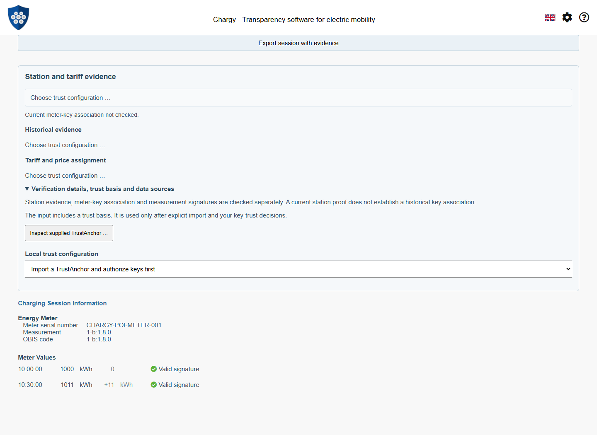
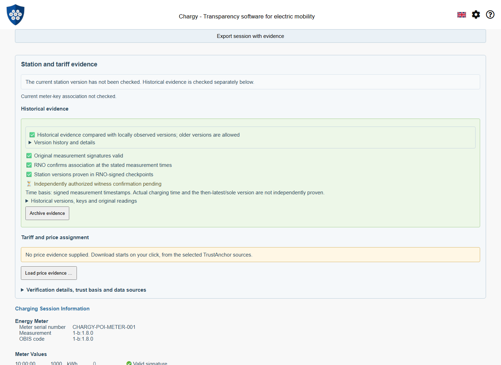
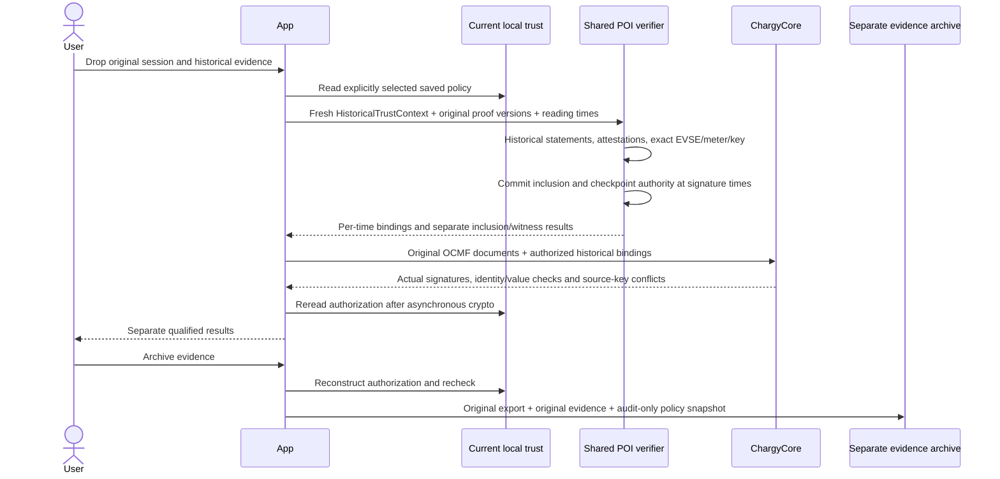
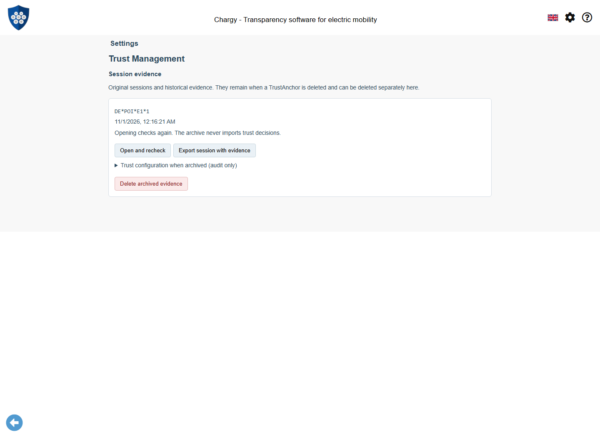
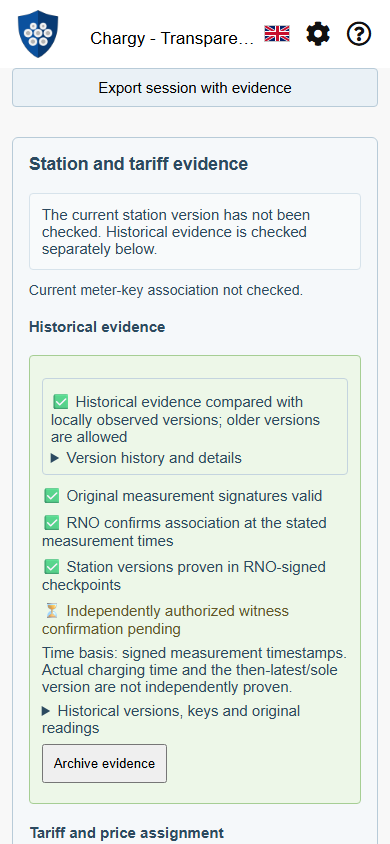
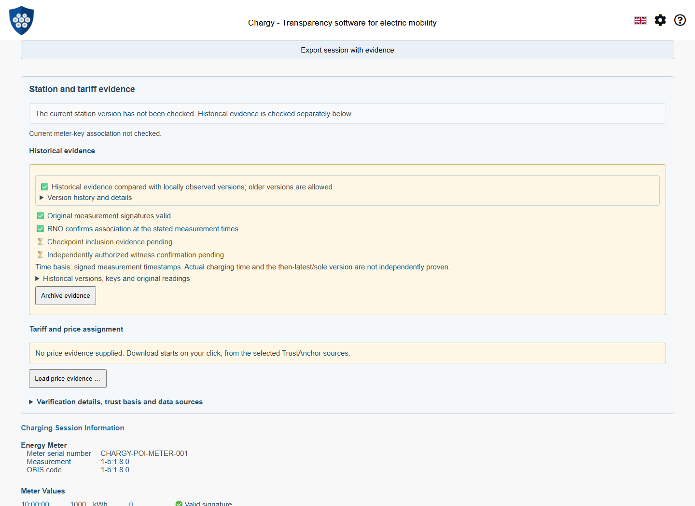

# Historical EVSE/Meter Evidence and Session Archives

Status: 2 November 2026. The mobile port uses the published npm releases
WWCP POI **0.2.0** and ChargyCore **0.18.0**. Package integrity is recorded in
package-lock.json; no development tarballs are required. See the
[mobile integration and verification guide](WWCP-POI-Mobile-Port.md).
This document distinguishes implemented flows from remaining proposals.

Chargy can now verify an archived station/key assignment at the **signed reading
timestamps**, then recheck the original OCMF with the corresponding keys. An
expired historical attestation, KeyStatement or operational certificate is not
automatically invalid: it must have been valid at the relevant historical time.
Today's local authorization is still required. A saved green result is never
reused as authority.

## A genuine archived session

Drop [archived-session.chargy](../tests/fixtures/POIHistory/archived-session.chargy)
onto the app or use the normal file chooser. Its signed start and end readings
are from **1 June 2026, 10:00–10:30 UTC**. The historical root attestations,
KeyStatement and operational certificates have expired before the fixed
1 November evaluation clock. A genuine checkpoint from 2 June uses different
operational signing keys and its own operator/KeyStatement snapshot.

The bootstrap is a currently valid statement for the same public demo identity
pins. In a fresh profile, inspect the supplied TrustAnchor, choose Import and
explicitly authorize the two independent holders. The file and its archival
policy metadata cannot authorize themselves.

The additional `expired-bootstrap-session.chargy` also has an expired bootstrap.
When inspected from a historical session, its signatures/key validity can be
checked at the original statement time and the document explicitly stored as a
historical reference. The dialog keeps today's expired-validity result visible
and labels this mode. Individual keys still require explicit confirmation; no
trust is imported from the archive. Generic current QR imports keep their usual
validity rules. A future or mathematically invalid reference is not accepted.
Importing an old historical reference also preserves an already valid current
reference for that anchor, so the archive does not downgrade current checking.





A witness genuinely signed the checkpoint, but the app currently has no local
witness-management policy wired into this path. Its signature therefore does
**not** become an independent trusted confirmation. The shared library accepts
explicit caller-authorized witnesses and a required witness count; those cases
are tested independently. Opening an RNO-supplied list cannot establish trust.

## Three clocks and their meanings

| Time | Used for |
| --- | --- |
| Original signed reading timestamp | Selecting the attested EVSE/meter/key assignment for that individual reading |
| Attestation, certificate and checkpoint signature times | Checking the relevant signed document and its authority at its own time |
| Current evaluation time | Reconstructing current local authorization, rejecting future inputs and bounding the in-memory check |

`HistoricalTrustContext` reconstructs today's local permission from the saved
anchor/pins and reference statement. The reference is authenticated at its own
signed time; it may be expired today. A newly issued current statement or live
server is not required to reopen an old archive. A one-minute in-memory operation
deadline bounds the check; it is not a lease on trust or historical validity.
The app compares the actual authorized holder groups and quorum again after
asynchronous crypto, so even a withdrawal leaving some other quorum intact
cannot preserve an old result.

The historical KeyStatement is checked at the reading time. Each checkpoint
signature is checked with the operator snapshot supplied for that checkpoint,
at that signature's own time. The verifier never sets every document's clock
to charging start. It rejects foreign RN/RNO identities and a quorum weaker than
the currently required quorum. Identity succession not connected to the current
authorized pins fails closed; no global-key fallback is performed.

Each original OCMF document is checked once with its uniquely authorized key.
All readings inside that signed document must use the same material. Different
documents may use different proven keys. Signed EVSE/meter identity, displayed
timestamps and values, source-key conflicts, cancellation and current-policy
expiry remain checked. An invalid original signature cannot yield a successful
historical association for that reading.



## Evidence wire structure

The existing app `poiEvidence/v1` extension now accepts `historicalEvidence`,
either as a JSON object or as original JSON text. Export uses text to preserve
signed decimal values. The parser accepts it through the same file, clipboard
and Drag & Drop routes as session evidence; no historical POI request is made
merely because a file was imported.

The following is an **abbreviated structural example**, not independently
verifiable input. The linked fixture contains all actual signed documents.

```json
{
  "poiEvidence": {
    "@context": "https://open.charging.cloud/contexts/chargy/poiEvidence/v1",
    "EVSEId": "DE*POI*E1*1",
    "roamingNetworkId": "CHARGY-POI-DEMO",
    "bootstrap": {
      "trustAnchor": "<original compact anchor>",
      "keyStatement": "<currently valid operator/KeyStatement JSON>"
    },
    "historicalEvidence": {
      "@context": "https://open.charging.cloud/contexts/wwcp/historicalMeterEvidence/v1",
      "EVSEId": "DE*POI*E1*1",
      "versions": [{
        "chargingStationProof": "<historical proof object, with its own old operator and attestations>",
        "commitProof": "<proof object linking that commit/root to a checkpoint>",
        "checkpoints": [{
          "checkpoint": "<original checkpoint object>",
          "operator": "<operator object with statement/certificates for checkpoint signatures>"
        }]
      }]
    },
    "archiveAudit": "<optional untrusted audit JSON text; never restored as trust>"
  }
}
```

`historicalMeterEvidence/v1` is an **experimental TS-library envelope**, not a
claim that this is already a standardized WWCP wire format. It composes existing
proof/checkpoint objects and leaves the existing strict `Evidence` schema intact.
Within the actual envelope the proof/checkpoint/operator fields are complete
JSON objects. The envelope requires no PriceStatements just to check a meter
assignment. Runtime price applicability and historical tariff publication are
separate work.

`verifyHistoricalMeterEvidence` produces per-time bindings shaped as follows
(abbreviated fields):

```json
{
  "evseId": "DE*POI*E1*1",
  "meterSerialNumber": "CHARGY-POI-METER-001",
  "key": { "id": "<original SPKI hash>", "canonicalId": "<material identity>" },
  "evidence": {
    "association": "historical-attestation",
    "measurementTimes": [1780308000000],
    "commitId": "<historical station version>",
    "historicalStatementDigest": "<old statement>",
    "keyStatementDigest": "<saved reference authenticated under today's local permission>",
    "verifiedAt": 1793492181000,
    "validUntil": 1793492241000,
    "attestationValidUntil": 1780311600000
  }
}
```

Here `validUntil` is the one-minute operation deadline, while the old attestation
expired on 1 June. These are authorized in-memory API inputs to Core, never authority that a
serialized input may grant itself. Core checks exact timestamp coverage against
the reparsed original documents. Overlapping statements naming different keys
for the same reading time are a conflict, not a prompt to try all keys.

## Durable archive, reopening and export

**Archive evidence** is an explicit user action. The separate IndexedDB database
`ChargySessionEvidence`, version 1, contains a `sessions` store. It retains the
normal session export, original OCMF/proof text, historical evidence, selected
policy identity, input source/receipt time, saving time and an audit-only snapshot
of the local key decisions and original saved reference KeyStatement. The record ID hashes the content
and policy association. No cached verification verdict is stored.



Settings → Trust Management → **Session evidence** offers:

- **Open and recheck:** use normal import and reconstruct current authorization.
- **Export session with evidence:** create a portable `.chargy` file, including
  the audit snapshot as untrusted metadata.
- **Delete archived evidence:** remove this archive explicitly.

Deleting an anchor/network removes its authorization and disposable proof cache,
but retains these independently stored session archives. Reopening one after
deletion cannot silently restore trust. The audit snapshot is inspectable and
exportable; it describes a past decision and is not applied as a present one.
Browser storage remains origin/profile-specific; exports provide a portable copy.
Automatic archive retention/eviction and remote backup are not implemented.



## Qualified results and remaining evidence

| Result | What it establishes |
| --- | --- |
| Original measurement signatures valid | The original documents verify with the explicitly associated historical keys |
| RNO confirms association at the stated measurement times | The authorized RNO attested the EVSE/meter/key assignment for those signed times |
| Station versions proven in RNO-signed checkpoints | The required RNO quorum signed checkpoints containing the selected station commits/roots |
| Checkpoint inclusion evidence pending | Assignment may be checked, but no durable checkpoint inclusion has been supplied |
| Independently authorized witness confirmation pending | No independently authorized witness result exists in this app path |



Neither an issuer-chosen `signedAt` nor a meter's signed timestamp establishes
independent actual time. A later checkpoint does not prove the version was public
before charging, the latest/sole applicable version, continuously installed
between readings or free of conflicting histories. Complete owner-signed change
replay, verified identity succession, checkpoint/epoch continuity, known-head
exchange and independent time/observation policy remain separate claims. Selected
checkpoint heads conflicting at the same network/epoch/sequence are rejected.

The shared API accepts caller-authorized compromise entries `{keyId, invalidFrom}`
for historical keys. They are never read from the evidence. Ordinary expiry is
distinct from compromise; proving that a signature predates compromise can also
require trusted time evidence. The app applies today's existing local key
withdrawals to the entire new check and rereads them after asynchronous work.
A dedicated dated-compromise management UI is not implemented.

The app currently consumes embedded evidence or archived exports. There is no
automatic historical server endpoint contract or full-history download. Providers
can deliver the same small bundle; a future bounded historical retrieval API
must resolve immutable commit/checkpoint IDs and preserve provenance.

## Fixtures, tests and screenshot maintenance

See the [fixture guide and provenance](../tests/fixtures/POIHistory/README.md).
The positive case has genuinely expired historical certificates and a later
checkpoint with different operational keys. Counterexamples cover a wrong time
window, overlapping contradictory assignments, tampered commit inclusion,
missing checkpoints and two non-overlapping key assignments. The latter keeps
an incompatible single container key visible as a conflict; it is not a complete
owner-signed key-succession history.

`tests/historicalSession.test.ts`, both library suites and the real-browser
capture cover original signatures, exact coverage, current trust, independently
authorized witnesses, expiry, compromise time, storage quota/retry, persistence,
export/reimport, anchor deletion, trust withdrawal during actual asynchronous
crypto and archive deletion. No positive trust or crypto outcomes are injected.

Run `npm run docs:screenshots:poi-history` after relevant UI/UX changes; inspect
all five images and update captions and `capture-info.json`. CI runs the same
browser checks and uploads the captures. Regenerate the public fixtures with
`npm run fixtures:poi-history:generate`; never extend signed validity without
signing again. The archive fixture deliberately stays old. No production roots
or automatic npm publication are involved.

The [session price evidence guide](WWCP-POI-Session-Prices.md) describes the implemented CPO-signed
price workflow, experimental fixed-at-start assignment, exact start-rate
comparison and separate price inclusion, with signed examples and screenshots.
Customer consent, pre-charge publication and full billing remain unproven.

The [persistent observed-version journal](WWCP-POI-Observed-Versions.md) additionally
checks authenticated contradictions across packets, tabs and reloads. Historical
inspection permits older coordinates and fixed-at-start prices without treating
them as current heads. Deleting trust or an archive does not clear that journal.
