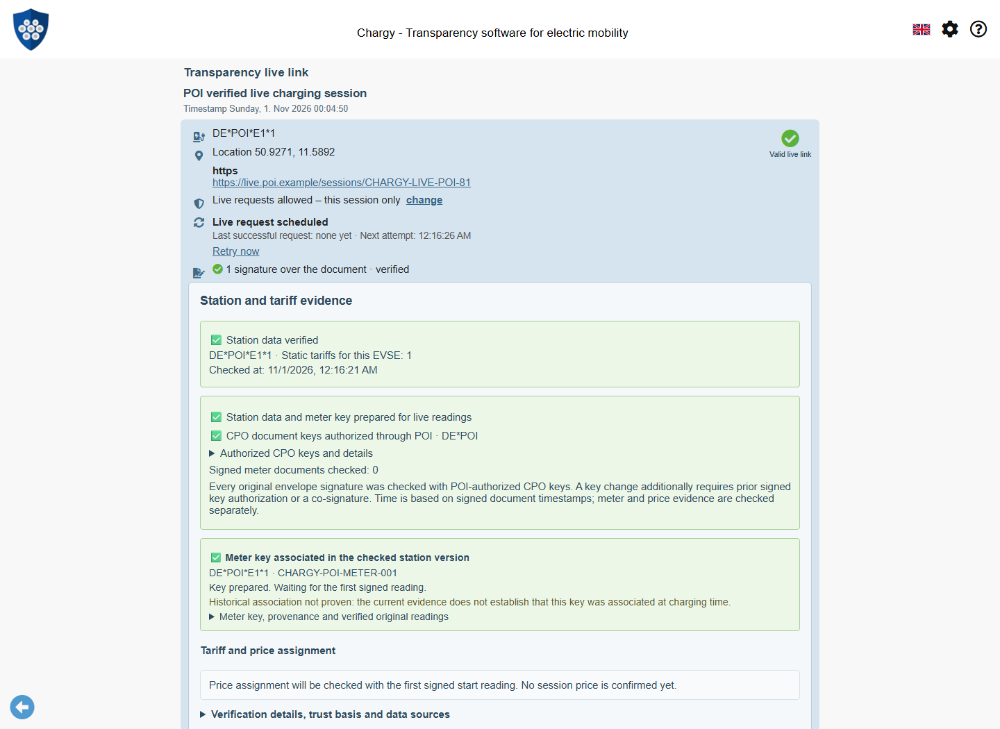
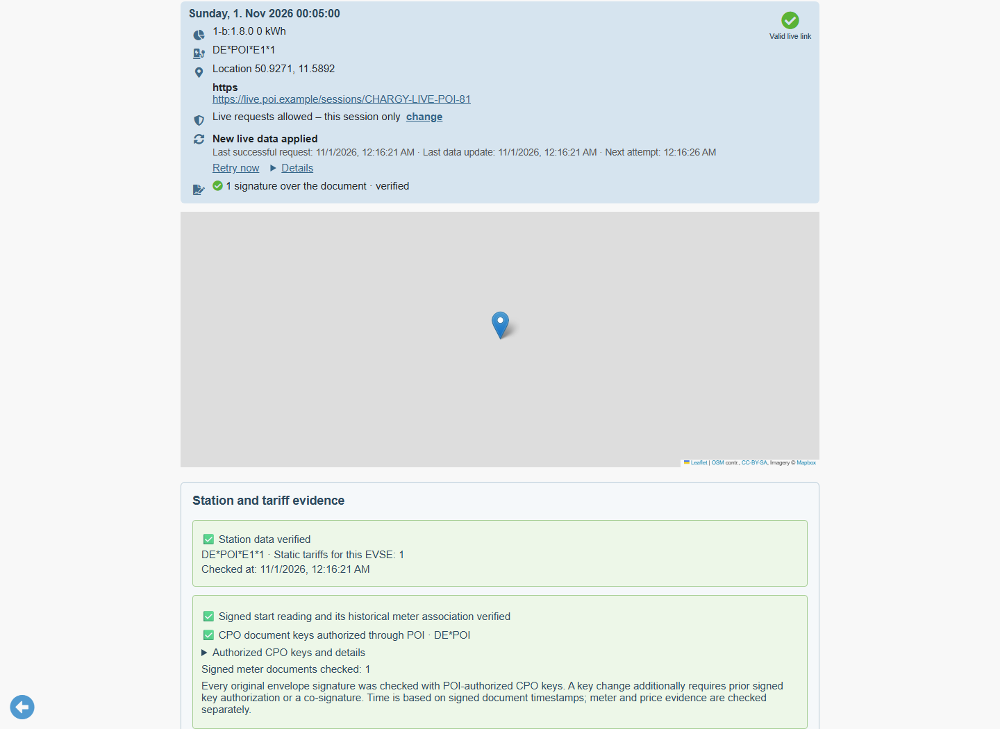
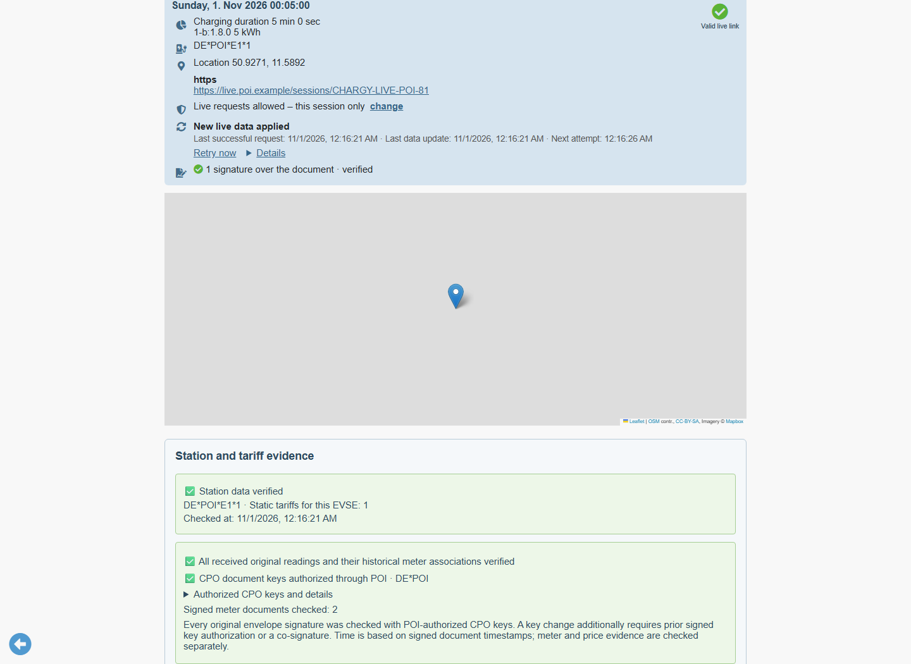
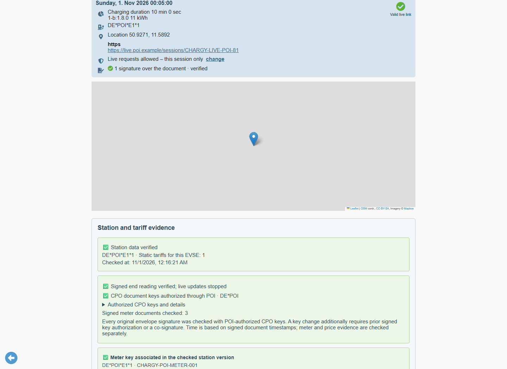
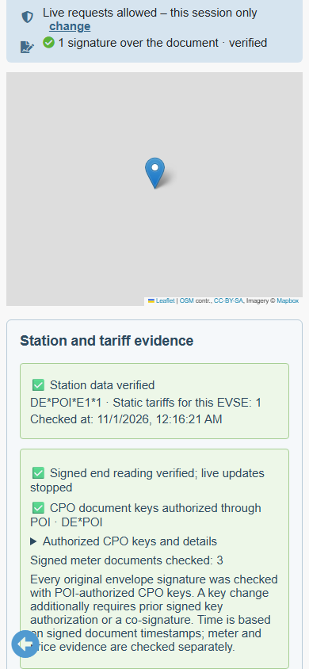
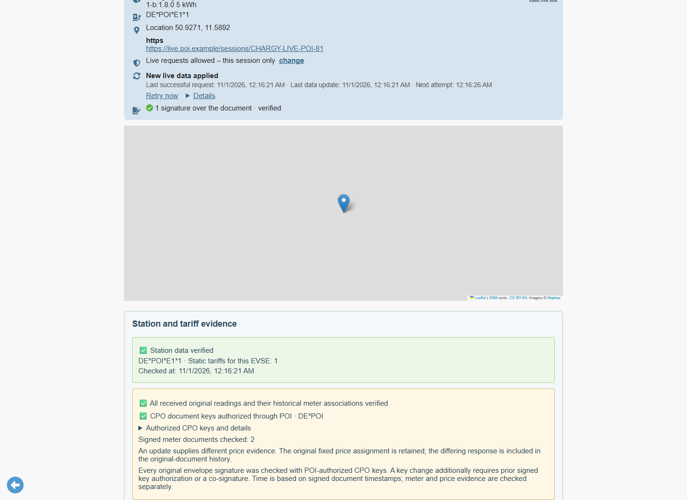
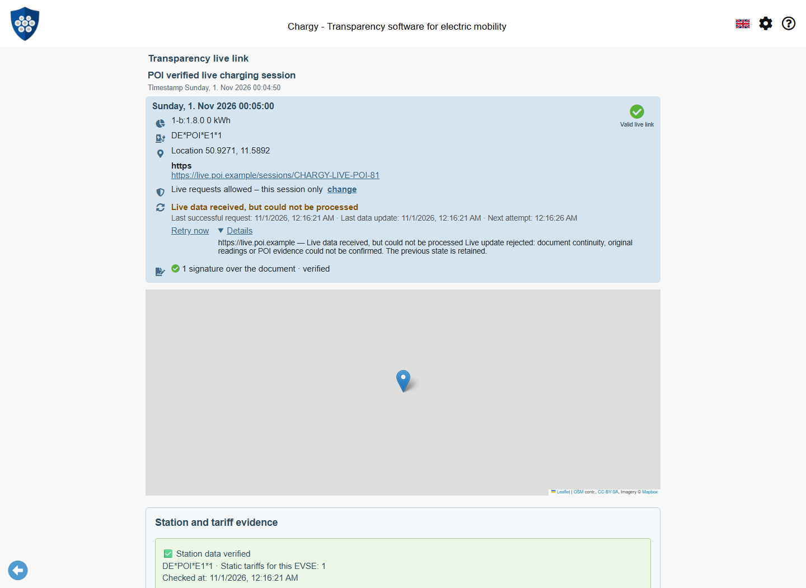

# WWCP POI: Complete Live-session Pilot

Status: 2 November 2026. The mobile port uses the published npm releases
WWCP POI **0.2.0** and ChargyCore **0.18.0**. Package integrity is recorded in
package-lock.json; no development tarballs are required. See the
[mobile integration and verification guide](WWCP-POI-Mobile-Port.md).
This document distinguishes implemented flows from remaining proposals.

The app prepares station data and a meter key before readings arrive. Each
candidate update then passes document continuity, original reading verification
and applicable price checks **before** replacing the accepted view. After a
verified end reading, polling stops. The completed record and its original
live envelopes can be archived and exported.

## The four phases

```mermaid
stateDiagram-v2
    [*] --> Waiting: Original live link and station evidence
    Waiting --> Prepared: Explicit local trust / selected policy
    Prepared --> Start: Original signed B reading verified
    Start --> Charging: Original signed C reading verified
    Charging --> Completed: Original signed E reading verified
    Completed --> Archived: Archive original evidence
    Start --> Start: Invalid update rejected; accepted originals retained
    Charging --> Charging: Different offer retained only as an observed proposal
```



| Input | Verification and display |
| --- | --- |
| `00-waiting.json` | Genuine signed envelope, no meter values. Verify the selected policy, station proof, exact EVSE/meter and declared meter key. Price assignment remains pending. |
| `01-start.json` | Original start at 00:05 UTC. Verify its historical key association and signature; check the experimental CPO assignment, fixed price, rate consistency and inclusion. |
| `02-intermediate.json` | Original intermediate at 00:10 UTC. Preserve the exact start and its price. Recheck every supplied original reading and its tariff text before adoption. |
| `03-completed.json` | Original end at 00:15 UTC. Verify all three readings and their associations; stop polling and allow evidence archival. |

The fixed evaluation clock is 2026-11-01T00:16:21Z. The demonstration streams
these signed versions under a reproducible clock; declared measurement times
are not independent evidence of actual time.











## Data and network flow

```mermaid
sequenceDiagram
    participant User
    participant App as Chargy MobileApp
    participant Local as Local trust and original evidence
    participant Live as User-approved HTTPS live source
    participant Core as ChargyCore and WWCP POI
    User->>App: Drop original waiting live link
    App->>Local: Read saved policy and current key decisions
    User->>App: Inspect supplied anchor and authorize test holders
    App->>Core: Verify embedded station proof and prepare meter key
    User->>App: Allow live transport origin
    loop Start and intermediate updates
        App->>Live: Bounded HTTPS request with lastUpdated
        Live-->>App: Original signed JSON candidate
        App->>Core: Check exact predecessor and cumulative originals
        App->>Core: Historical association and original meter signatures
        App->>Core: Fixed CPO assignment and every original tariff text
        App->>Local: Re-read current authorization
        alt All required admission checks pass
            App->>Local: Retain original envelope and fixed price evidence
            App-->>User: Adopt and display new readings
        else Invalid, withdrawn trust or cancelled selection
            App-->>User: Reject update; keep previous accepted view
        end
    end
    Live-->>App: Candidate with signed end reading
    App->>Core: Verify end and all preceding originals
    App-->>User: Completed; polling stopped
    User->>App: Archive evidence
    App->>Local: Completed record, exact live envelopes and audit-only policy
```

The live source's URL comes from the imported live link and follows the existing
origin consent, HTTPS, redirect, timeout and payload-limit rules. POI sources
come from the selected saved TrustAnchor. Embedded POI evidence needs no POI
request. When only an EVSE is known, the existing explicit station-proof control
can prepare the meter key; a successfully prepared proof is retained for later
updates. This pilot does not introduce an unrestricted automatic roaming-network
or historical-proof discovery service.

Evidence omitted by a later update is inherited **by field**. A response that
omits `poiEvidence` or just one of its fields cannot silently remove the station
proof, historical evidence, public bootstrap or fixed price. Conflicting station
or historical proof replacements require an explicit transition and are rejected
by this strict pilot. A selected policy remains selected across updates; its
current authorization is reconstructed on every check.

## Original JSON structures

The following is a shape example. Placeholder strings stand for complete signed
objects/OCMF strings from the fixtures, rather than independently verifiable
signature values.

```json
{
  "@id": "CHARGY-LIVE-POI-81",
  "@context": "https://open.charging.cloud/contexts/chargeTransparency/live/link/1.0",
  "created": "2026-11-01T00:04:50.000Z",
  "lastUpdated": "2026-11-01T00:05:01.000Z",
  "updates": "<SHA-256 of the JCS-encoded entire previous envelope>",
  "docRefIdGeneration": ["SHA-256", "hex"],
  "keyIdGeneration": ["SubjectPublicKeyInfo", "DER", "SHA-256", "hex"],
  "chargingSessionId": "ADHOC-LIVE-POI",
  "chargingStationOperator": {
    "@id": "DE*POI",
    "publicKeys": [{
      "keyUsage": ["signCTRs"],
      "algorithm": "EdDSA-Ed25519",
      "encodings": ["SubjectPublicKeyInfo", "DER", "hex"],
      "value": "<public test document key>"
    }]
  },
  "chargingStation": {
    "@id": "DE*POI*S1",
    "EVSE": {
      "@id": "DE*POI*E1*1",
      "energyMeter": {"serialNumber": "CHARGY-POI-METER-001"}
    }
  },
  "liveTransports": [{
    "type": "https",
    "urls": ["https://live.poi.example/sessions/CHARGY-LIVE-POI-81"],
    "refresh": 5
  }],
  "signedMeterValues": {
    "encodings": ["OCMF"],
    "values": ["<exact signed OCMF start document>"]
  },
  "poiEvidence": {
    "@context": "https://open.charging.cloud/contexts/chargy/poiEvidence/v1",
    "EVSEId": "DE*POI*E1*1",
    "chargingStationProof": "<original station proof JSON text>",
    "historicalEvidence": "<original historical evidence JSON text>",
    "priceEvidence": "<original session price evidence JSON text>"
  },
  "signatures": [{
    "keyId": "<SHA-256 of the document key's DER SPKI>",
    "algorithm": "EdDSA-Ed25519",
    "signedData": {
      "excludedProperties": ["signatures"],
      "encodings": ["JSON", "JCS", "UTF-8"]
    },
    "encodings": ["hex"],
    "value": "<genuine document signature>"
  }]
}
```

The waiting envelope omits `signedMeterValues`. The start envelope includes the
full POI evidence; the intermediate and completed envelopes deliberately omit
it. Their cumulative `values` arrays retain every previous OCMF string byte for
byte. The fixture's middle reading uses OCMF transaction code **C**.

The entire previous envelope, including its signatures, determines `updates`.
Document signatures cover the entire current envelope except `signatures`.
Runtime verification fields are never used to reconstruct those signature inputs.
The strict pilot accepts only the SHA-256/JCS reference profile and refuses
partial signature coverage, future version times, changed session/EVSE/meter
identities, unknown document-key transitions and removed/reordered/replaced
original readings. Same-time conflicting documents and replays of earlier
versions are rejected rather than reported as an unchanged current version.

## Fixed price across updates

The experimental assignment and gross-rate profile are described in the
[session price guide](WWCP-POI-Session-Prices.md). An unbound offer before the first verified start does not pin a session price.
The selected offer is active at the original start and expires before the session ends. Rechecking later
readings does not rebind this fixed-at-start session to a current offer.

Every original tariff text is compared only after the corresponding original
meter signatures and historical associations pass. A genuine signed intermediate
with 65 cents instead of the selected 35 cents is rejected. A different price
bundle supplied by a later envelope is retained in the original-envelope history
and produces a visible warning; it does not overwrite the fixed price. A valid
reading update may still proceed under the retained original fixed assignment.





Missing inclusion remains visibly pending. Invalid inclusion cannot establish
admission. Customer consent, pre-start publication, globally latest/sole offers,
independent time, tax, quantities, steps, rounding and final billing correctness
are not established by this pilot.

## Signature authority and scope

Envelope continuity is supplemented by [independent POI CPO authority](WWCP-POI-Trust-Succession.md):
every original envelope signature must verify with valid document keys from the
proven CPO of this station/EVSE. The explicit `chargeTransparencyRecords` usage is
a library extension; price-only keys cannot authorize envelopes. A CPO document
key change also requires authorization by the preceding completely signed key list
or an old/new co-signed bridge. Self-signature or a new key list alone cannot
establish the first envelope's authority.

Meter and price authority are checked independently through the selected local
TrustAnchor, the RNO-attested station/key association and CPO price signatures.
The generic live-link signature badge is not a substitute for those checks.
The pilot does not add meter algorithms beyond the existing P-256/OCMF handoff.

Incremental-only meter payloads, missing predecessor versions, station/key
rotation within a stream and variable/contract price transitions need additional
profiles. The strict pilot rejects these transitions instead of guessing.
This per-session predecessor check is not persistent cross-session rollback or
global fork protection.

## Archive and reproducibility

Archiving after the verified end produces a normal completed Chargy record with
three original readings. `poiEvidence.liveDocuments` additionally retains the
four exact source envelopes; the selected price and historical proofs remain in
their original JSON text. The live envelope history is bounded to 4 MiB as a
serialized JSON array. At the limit the next update is rejected; older evidence
is never silently evicted. Individual live envelope input is bounded to 4 MiB.
An explicitly downloaded price also remains attached across later live updates.
Completed export associates POI evidence with the resulting record session ID,
while the original live-link ID remains in the retained source envelopes.
The browser suite exercises this path with freshly signed transport envelopes
and a real selected-anchor price download.

Original envelopes and source/policy snapshots are audit data, not permission
to trust keys. Opening an exported archive uses today's local decisions and
rechecks the original historical readings and selected price. A fresh browser
profile receives no authorization from an archive. The normal archive view does
not replay a live transport or restore its old green flags.

Start with [00-waiting.json](../tests/fixtures/POILive/00-waiting.json) via file,
clipboard or Drag & Drop. Allow its test HTTPS origin, inspect the supplied
anchor and explicitly accept its two public test holders. A provider must serve
the following versions at the declared endpoint; the browser capture routes
those responses locally and requires no external server. The
[fixture guide](../tests/fixtures/POILive/README.md) lists counterexamples.

Run `npm run fixtures:poi-live-pilot:generate` to regenerate genuine signatures.
Run `npm run docs:screenshots:poi-live-pilot` for the real-browser interaction
checks and seven screenshots. Regenerate and visually review images and capture
metadata whenever this workflow changes. CI runs the same capture. No production
roots or success outcomes are injected. Shared Core tests use portable copies
of the same four original envelopes; update those copies when regenerating the
library's corresponding test vector.

## Durable rollback/fork knowledge and reopening

The [observed-version journal](WWCP-POI-Observed-Versions.md) now survives reloads,
source switches and TrustAnchor deletion. It records authenticated live positions,
pinned document identity, original envelopes and the selected public POI evidence.
Genuine rejected equivocation is retained only after verification under previously
accepted document keys. Initial and subsequent CPO authority is checked separately
through POI. Explicit dual-quorum trust succession and verified epoch continuation
retain old coordinates; see the [succession guide](WWCP-POI-Trust-Succession.md).

An old QR snapshot cannot reset a newer remembered live head. Reopen the accepted
chain through Settings → Trust Management → Observed versions → Open last observed
live data and recheck. Original documents, meter signatures and prices are checked
again using current key decisions. Explicit history reset removes this protection
and cancels pending checks; it retains trusted keys and the separate evidence archive.

The [experimental publication pilot](WWCP-POI-Price-Publication.md) adds a separate
organization/network/clock policy and signed public-retrieval receipts. Its new
live fixture retains the exact selected price and scoped pre-signed-start claim
through completion. Receipt enrichment does not reprice a pinned session.
