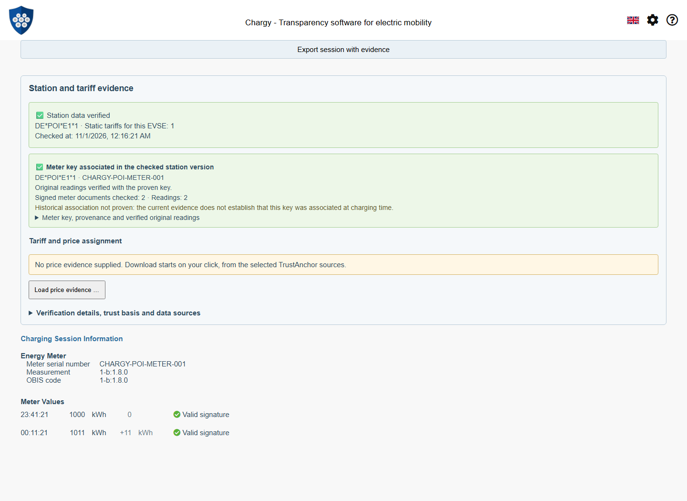
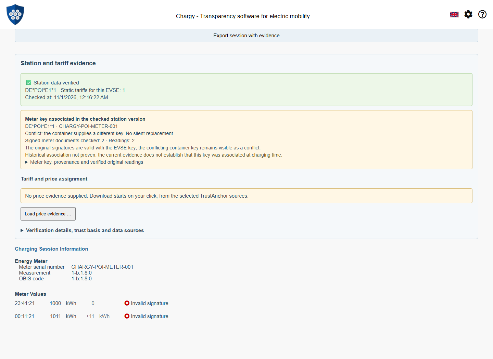
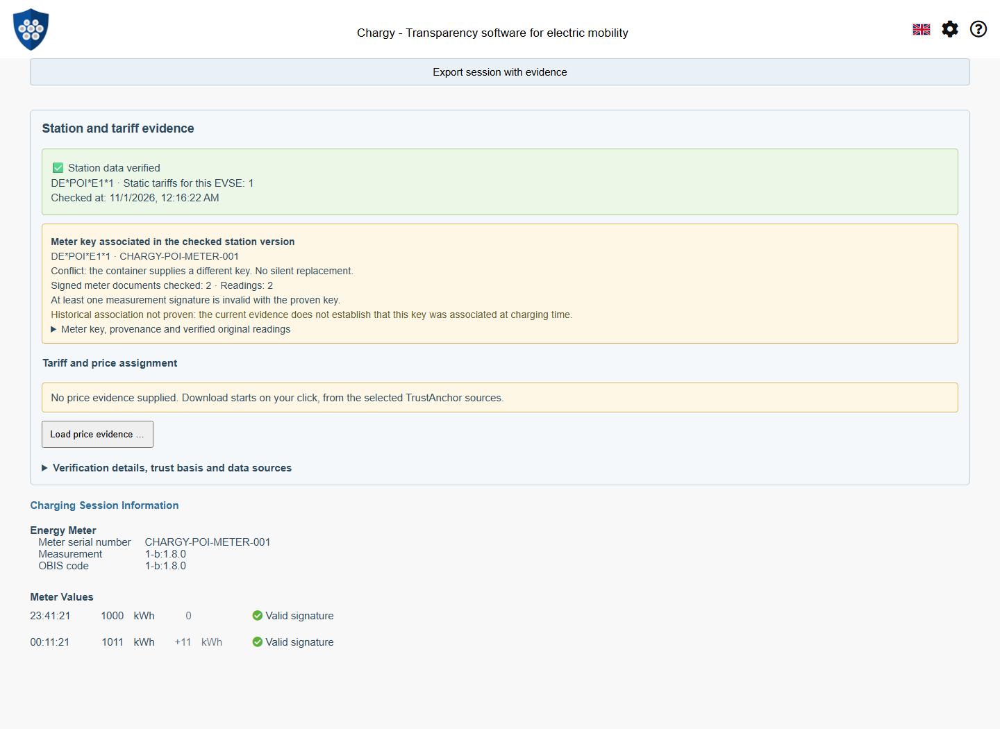

# Proven Meter Keys: Shared POI Association and Core Verification

Status: 2 November 2026. The mobile port uses the published npm releases
WWCP POI **0.2.0** and ChargyCore **0.18.0**. Package integrity is recorded in
package-lock.json; no development tarballs are required. See the
[mobile integration and verification guide](WWCP-POI-Mobile-Port.md).
This document distinguishes implemented flows from remaining proposals.

The app now reconstructs current local authorization, verifies the original
station proof, selects the selected EVSE's explicitly associated meter/key and
asks Core to recheck the **original OCMF documents with that key**. It neither
rewrites signed data nor relies on previously cached green verification flags.

## Shared responsibilities

| Component | Responsibility |
| --- | --- |
| WWCP_POI.TS `verifyMeterKey` | TrustContext-bound proof verification; exact EVSE and meter serial; explicit key choice; key decoding/ID validation; immutable association and provenance |
| WWCP_POI.TS `parseMeasurementPublicKey` | Explicit SPKI or COSE interpretation; P-256 point validation; original ID scheme and comparable canonical material identity |
| ChargyCore `verifyOCMFSessionWithMeterKey` | Reparse originals with exactly the caller-authorized key; signed meter/EVSE and displayed-value binding; actual signatures, source-key conflict, expiry and cancellation |
| App | Current local decisions before and after asynchronous work, source-policy selection, operation lifetime, UI, original-data export |

Core has no dependency on POI or IndexedDB. An `IMeterKeyBinding` supplied through
the API is an **authorized caller input**, not a token that untrusted JSON can
grant itself. The app never reads a serialized binding as authority; it recreates
it from local policy and the original proof. Local revocation during crypto work
prevents the final success from being displayed.

```mermaid
sequenceDiagram
    participant App
    participant Local as Current local trust
    participant POI as WWCP_POI.TS
    participant Core as ChargyCore
    App->>Local: Fresh policy / KeyStatement / exclusions
    App->>POI: TrustContext + original EVSE proof + signed meter identity
    POI-->>App: Verified meter-key binding and current observation interval
    App->>Core: Original OCMF + explicitly authorized key + provenance
    Core->>Core: Compare source key; reparse signatures and signed MS/CI
    Core->>Core: Compare displayed timestamp/value/unit/scale/OBIS with originals
    Core-->>App: Verified, conflict, invalid, unsupported or expired
    App->>Local: Reread authorization after asynchronous verification
    App-->>App: Render separate association / signature / historical results
```

## Key identity and format

The legacy WWCP measurement-key profile uses Base64 DER-SPKI with
`SHA-256(SPKI)` IDs. Operator COSE keys use a different derivation. The shared
parser accepts an **explicit** `spki-der` or `cose-key` profile, validates the
corresponding ID and produces a canonical public COSE key/thumbprint for material
comparison. A 64-character ID never chooses the profile. The original ID,
derivation scheme and source representation remain available.

The current app explicitly uses the legacy SPKI measurement profile. The pilot
supports uncompressed ECDSA P-256 keys and P-256 OCMF signatures. Other curves,
PQC measurement keys, station-owned measurement signers, missing signed EVSE IDs
and ambiguous key sets are explicit unsupported/unproven cases. RNO/CPO signing
keys are never substituted. Multiple meter keys require an explicit key ID in
the library; the app currently reports ambiguity instead of trying every key.

The neutral Core handoff is structurally shaped as follows (values abbreviated;
this example is not independently verifiable evidence):

```json
{
  "evseId": "DE*POI*E1*1",
  "chargingStationId": "DE*POI*S1",
  "meterId": "DE*POI*M1",
  "meterSerialNumber": "CHARGY-POI-METER-001",
  "key": {
    "id": "<SHA-256 of original SPKI>",
    "idScheme": "sha256-spki",
    "canonicalId": "<COSE key thumbprint of equivalent material>",
    "value": "<Base64 deterministic public COSE key>",
    "encodings": ["COSE_Key", "CBOR", "base64"],
    "algorithm": "ECDSA-secp256r1"
  },
  "evidence": {
    "roamingNetworkId": "CHARGY-POI-DEMO",
    "roamingNetworkOperatorId": "CHARGY-DEMO-RNO",
    "commitId": "<attested version>",
    "revision": 1,
    "treeRoot": "<attested effectiveTree root>",
    "keyStatementDigest": "<bound statement digest>",
    "verifiedAt": 1793492181000,
    "validUntil": 1793574981000,
    "association": "current-snapshot"
  }
}
```

The observation expires no later than its KeyStatement, counted root attestations
and the certified signing/identity keys used for them. This is a conservative
bound, not an authorization lease; current local decisions must still be read.
Raw byte strings and documents are retained; normalization does not rewrite an
OCMF payload or a signed live envelope.

## Visible results and counterexamples

The result adds **Meter key associated in the checked station version** and the outcome
of checking the original readings with that key. Details expose original and
canonical fingerprints, meter identity, source version, checked time/expiry and
buttons for the newly verified original readings' crypto details. A single
signed start reading reports start-signature validity and consumption pending.
OCMF crypto details show each individual reading's result, so a valid start
reading does not inherit the invalid end reading's aggregate session verdict.



| Fixture in `tests/fixtures/POISession` | Expected result |
| --- | --- |
| `completed-session-with-evse-proof.chargy` | Current EVSE key association and both original signatures pass |
| `container-key-conflict.chargy` | Source container key conflicts; original signatures pass with the EVSE key; conflict remains visible |
| `foreign-meter-key-proof.chargy` | Station proof is genuinely valid but names another key; original signatures fail with that key |
| `wrong-meter-proof.chargy` | Signed OCMF meter differs from the proven EVSE meter; no key association |
| `ambiguous-meter-keys.chargy` | No implicit key selection or trial verification across candidates |
| `tampered-end-reading.chargy` | Static proof remains valid; original end signature fails |

The counterexample proofs are genuinely re-signed with the public demo RNO keys
after changing their meter declarations. Only the deliberately tampered OCMF
payload is left with an invalid signature. The generator signs new attestations;
it never extends an existing signed timestamp without signing again.





Exports preserve the original public-key description and the original OCMF/proof
text. Reimporting an exported conflicting example must still show the conflict.
The app keeps the original Core/container verdict separate from this new
proven-key check, rather than silently replacing it.

## Historical limits and remaining work

**Historical association not proven** remains visible even after current
association and signature checks pass. A fresh proof and a valid old signature
do not prove that this key was assigned to that EVSE when charging occurred.
The signer-chosen measurement timestamp alone cannot establish that association.
The separate [historical evidence path](WWCP-POI-Historical-Sessions.md) now
checks original signed reading times against historical RNO attestations and
optional checkpoint inclusion, and archives original evidence plus an audit-only
policy snapshot. It does not backdate local trust or transform current
attestations into historical evidence. Complete succession and independent
time/publication evidence remain separate work.
An unexpired attested snapshot also does not establish that no newer version
exists elsewhere; the UI names the checked station version instead of asserting
globally latest membership.

The APIs can prepare a current key before readings arrive and check a single
original start value. The existing live transport can reuse the session-bound
panel. The [complete live pilot](WWCP-POI-Live-Pilot.md) now supplies a matching signed
series and strict cumulative update admission; the older live fixture remains a
different station. Wider discovery, key transitions and persistent global
rollback protection remain future work. The [session price workflow](WWCP-POI-Session-Prices.md) now
checks CPO prices and an experimental assignment separately. EMP offers and
independent pre-charge publication evidence remain future work.

## Tests and maintenance

Both shared libraries pass their Node, built-package and Chromium suites. New
tests cover true SPKI/COSE identity, invalid IDs/encodings, source substitution,
current trust, wrong meter/EVSE, ambiguity, original signatures, displayed-value
tampering, conflicting keys, expiry and a single start value. A re-signed test
also proves that an earlier RNO certificate expiry caps the observation.

The app's browser script uses genuine Drag & Drop and explicit two-holder trust.
It checks the positive case, all counterexamples, original crypto details,
conflict-preserving export/reimport, current-time expiry and trust withdrawal
during delayed **real** SHA-256 work. It never supplies a fake crypto result.

Run `npm run docs:screenshots:poi-session` and inspect all seven images after
relevant UI or handoff changes. Keep captions, provenance and capture metadata
current; the same script runs in CI. Fixture regeneration remains
`npm run fixtures:poi-session:generate`. The normal app rejects expired demo
attestations; only reproducible screenshot/test clocks use the recorded fixture
time. No production keys or automatic npm publication are involved.

The [session price evidence guide](WWCP-POI-Session-Prices.md) describes the implemented CPO-signed
price workflow, experimental fixed-at-start assignment, exact start-rate
comparison and separate price inclusion, with signed examples and screenshots.
Customer consent, pre-charge publication and full billing remain unproven.

The [complete cumulative live pilot](WWCP-POI-Live-Pilot.md) is now implemented, including
preparation before readings, verification before adoption, fixed-price retention,
verified completion and original-envelope archival. Wider discovery, variable
prices, independent witnesses and envelope-signer authorization remain separate.
