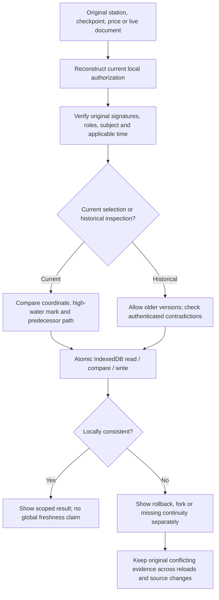
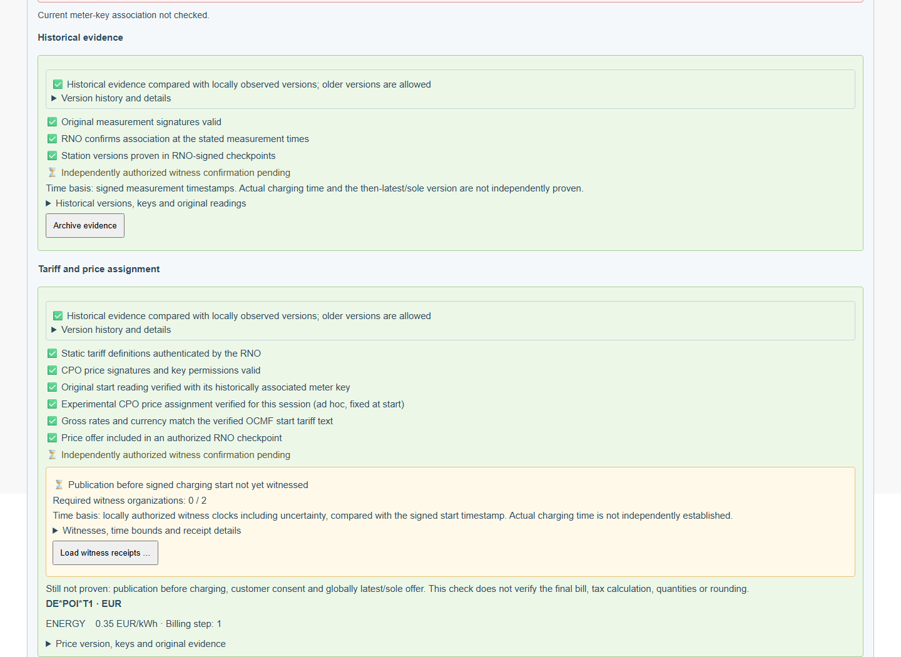
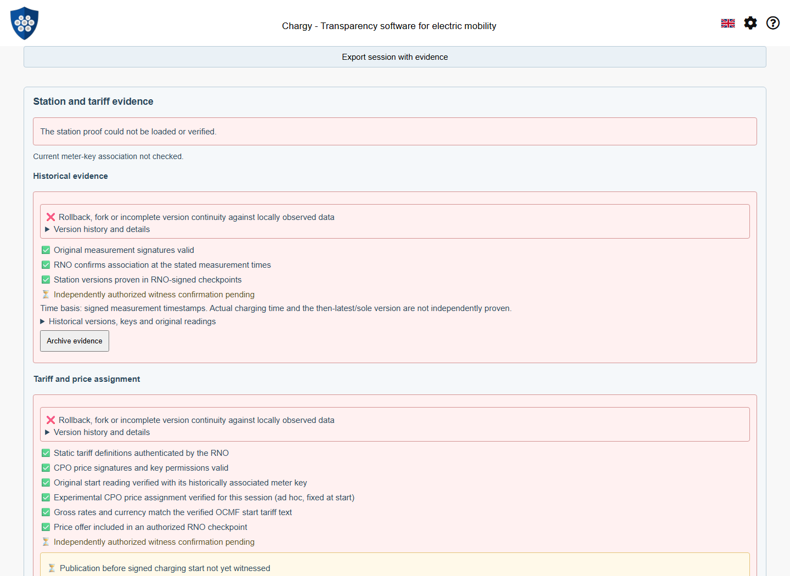
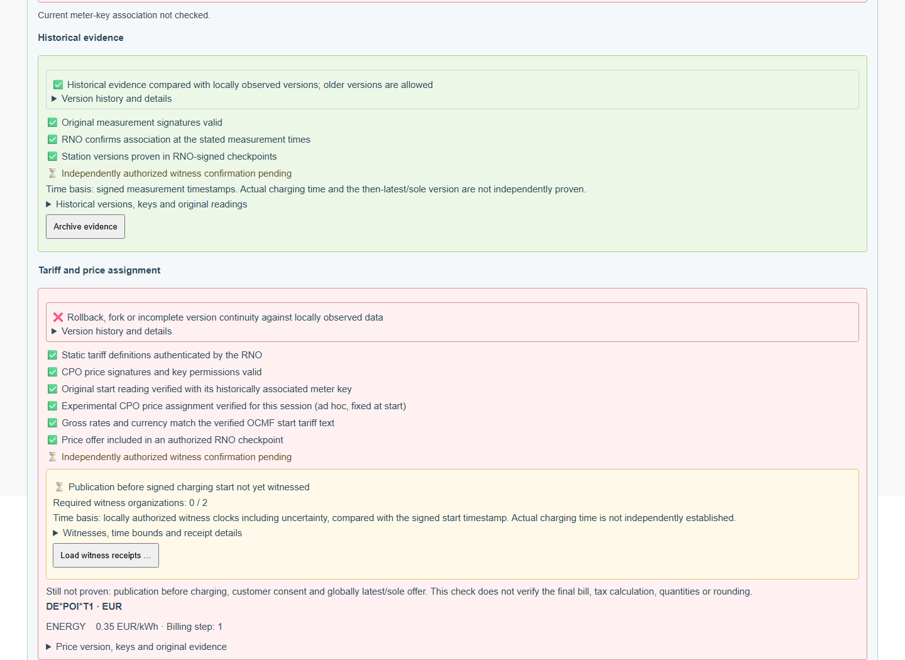
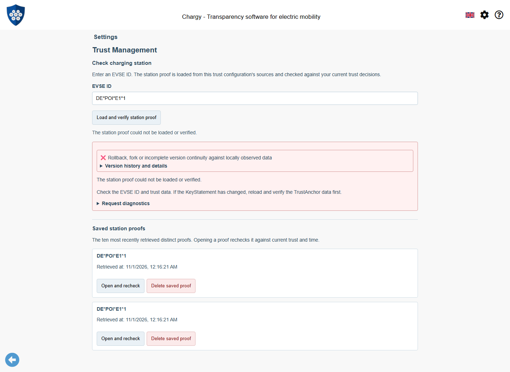
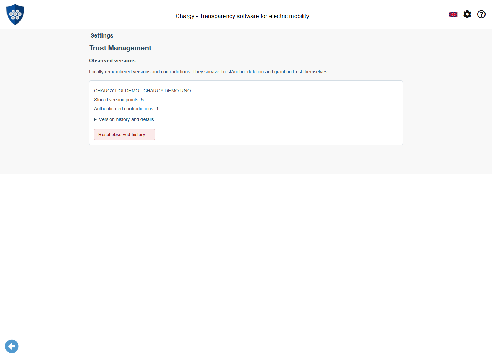
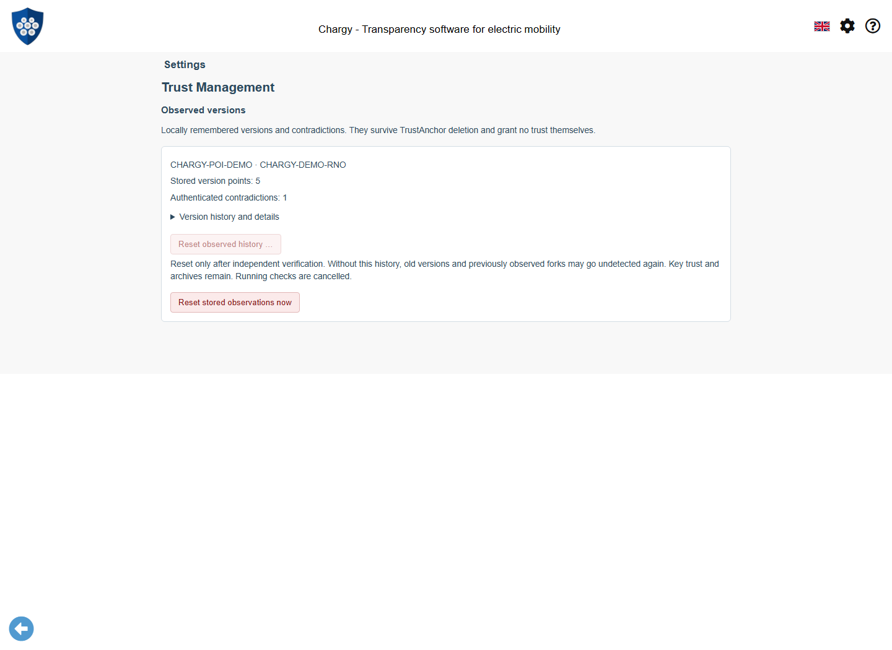
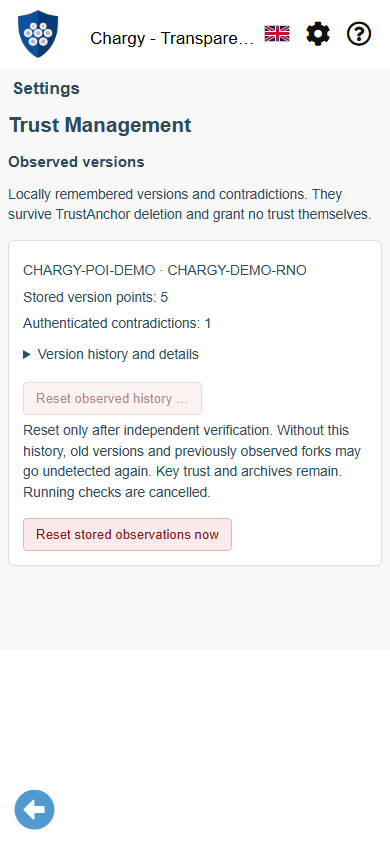
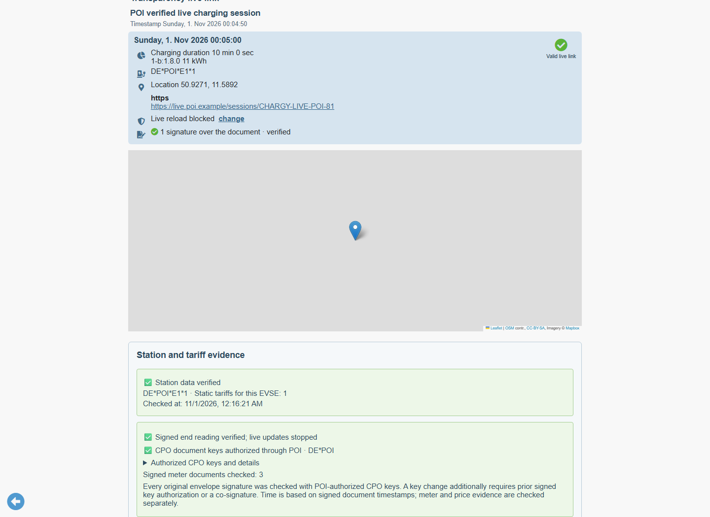

# Persisting locally observed WWCP/POI versions

Chargy remembers authenticated versions across reloads and tabs. A source cannot
silently replace a previously observed current station revision with an older one,
and switching back to the first source cannot hide a proven fork. This is a local
consistency check. It does not establish the globally latest state, actual time,
independent witnesses or the absence of an unseen competing offer.

## Authentication, consistency and historical use

The shared `@open-charging-cloud/wwcp-poi` development candidate provides the pure
`compareObservedVersions` policy and metadata projections. The app owns IndexedDB,
local decisions, UI and cancellation. Normal signature, role, subject, validity
and quorum verification runs before observations enter the journal. Projection
helpers alone do not verify signatures or grant authority.



| Kind | Coordinate | Current selection | Historical inspection |
| --- | --- | --- | --- |
| Station root | RN revision → commit ID | Reject lower known revisions or a different commit at the same revision. Signed snapshot jumps are allowed; commit ancestry is not thereby proven. | Allow older revisions; retain contradictions. |
| Checkpoint | RN + epoch + sequence → checkpoint ID | Require a path to the accepted head, increasing revisions and explicit support for an epoch change. | Allow old checkpoints; detect same-coordinate forks and contradictory known adjacent links. |
| PriceStatement | Entity chain + sequence → statement digest | Require supplied/remembered predecessor continuity; reject lower known sequence or forks. | An original fixed-at-start price remains applicable despite newer offers. |
| Live envelope | Opaque link ID + declared update time → original document reference | Require the remembered predecessor path and stable identity/document keys. | Record demonstrable equivocation without adopting a rejected candidate. |

Checkpoint observations also record the checkpoint's authenticated root revision
and commit ID. This prevents a current station response from regressing behind a
newer locally known checkpoint. Historical inclusion of an older station remains
possible. Session-price checks use the historical mode; `verifyCurrentPrices` is
the explicit service entry point for callers checking a current offer.

The two session examples below have the same original start and fixed price of
0.35 EUR/kWh. The later checkpoint also contains newer 0.40/0.45 offers which
become valid after that start. Inspecting the older session must still succeed.



## High-water marks, gaps and forks

Only an accepted **current** comparison advances current heads. An authenticated
observation received during historical inspection, rollback or a missing-link
rejection still contributes negative knowledge. A signed checkpoint 2 received
after accepted checkpoint 0 therefore raises a continuity error until checkpoint
1 is supplied. Repeating checkpoint 2 does not turn that rejection into success.
Supplying 1 may itself be too old for current selection, but provides the missing
authenticated link; 2 can then be retried against the accepted 0 → 1 → 2 path.

A same-coordinate/different-digest fork, an authenticated pinned-identity change,
contradictory adjacent predecessor links, or two signed live children of one
predecessor is retained. That affected chain remains quarantined until an explicit
local reset. Unrelated entity chains are not merged into it. Invalid signatures
and self-signed replacement document keys cannot poison the authenticated history.

For rejected live updates, Chargy additionally verifies the candidate under the
previously accepted document keys before recording a demonstrable contradiction.
This continuity check is supplemented by the independent POI CPO-envelope
authority check, including the initial envelope, described in the succession guide.
Meter association and meter/price signatures retain their separate POI checks.
Merely observing an invalid reading in a signed envelope does not adopt that
envelope or advance its live head.







## Durable storage and recovery

The separate database `ChargyPOIObservedHistory`, schema version 1, contains a
`scopes` store. Each scope binds the exact saved TrustAnchor policy, authenticated
RN and RNO. A different URL policy, holder configuration or quorum does not inherit
another policy's history. Unrelated policies are not automatically merged. The
[explicit compact succession profile](WWCP-POI-Trust-Succession.md) now verifies
both holder quorums and epoch continuation while retaining this journal.

The following is a **storage-shape illustration**, with abbreviated hashes and
originals; it is not a signed import fixture:

```json
{
  "id": "SHA256({roamingNetworkId, roamingNetworkOperatorId, anchorPolicyId})",
  "policyId": "saved-anchor-policy-id",
  "roamingNetworkId": "CHARGY-POI-DEMO",
  "operatorId": "CHARGY-POI-DEMO-RNO",
  "generation": "fresh-local-UUID",
  "updatedAt": 1793492181000,
  "state": {
    "version": 1,
    "points": [
      {
        "kind": "checkpoint",
        "chain": "network",
        "epoch": "1",
        "position": 2,
        "revision": 2,
        "digest": "checkpoint-2-id",
        "previous": "checkpoint-1-id",
        "original": "original authenticated checkpoint JSON"
      }
    ],
    "heads": {
      "[\"checkpoint\",\"network\"]": {
        "epoch": "1",
        "position": 2,
        "digest": "checkpoint-2-id"
      }
    },
    "conflicts": []
  },
  "liveEvidence": {},
  "checksum": "SHA256(canonical JSON of this record excluding checksum)"
}
```

Read, comparison and replacement occur in one IndexedDB read/write transaction,
including simultaneous tabs. A checksum detects accidental record corruption;
it is not protection against a local attacker who controls browser storage/code.
The journal is neither an authorization cache nor a stored green verdict. Every
operation reconstructs current key decisions. Trust withdrawal, authorization
expiry, cancellation and an intervening history reset prevent pending success.

Deleting a TrustAnchor, cached proof, or evidence archive does not erase this
journal. In **Settings → Trust Management → Observed versions**, users can inspect
stored coordinates and original contradictory evidence. Resetting is a separate,
explicitly confirmed action. It clears that scope's points/heads/conflicts/live
snapshot and rotates its generation. Key decisions and evidence archives remain.
Running views/checks are invalidated locally and in other tabs. Resetting removes
the protection against those previously observed versions; independent resolution
of a fork must precede such a decision.







There is no silent eviction. Limits are 4096 points, 128 conflict records and
16 MiB per scope, plus the existing 4 MiB live-original archive bound. Storage
unavailability, quota errors, unsupported/corrupt records and exceeded capacity
fail closed. No production in-memory fallback replaces lost negative knowledge.
Clearing site data or losing the browser profile necessarily loses this local
protection. Journal export/backup, profile migration and conflict resolution using
independently authorized witnesses remain future work. A corrupt journal currently
requires browser-storage recovery; it is never silently recreated as empty.

## Reopening live data after reload

The original QR snapshot may now be older than the latest authenticated live
version remembered by Chargy. Importing it again cannot bypass the journal. Use
**Open last observed live data and recheck** in Observed versions instead.

Chargy follows the accepted live head back through its exact retained originals,
restores public POI evidence and the selected fixed-price document, and rechecks
the chain, original readings and prices under current local trust. The saved
evidence does not restore deleted keys or permissions. The ordinary session
evidence archive remains an independent historical export, not live authorization.



## Reproducing the checks

The [fixture guide](../tests/fixtures/POIObservedVersions/README.md) explains genuine
quorum-signed versions, old fixed prices and cross-packet forks. All keys are public
test keys. No success flags or production trust roots are injected.

```sh
npm run fixtures:poi-observations:generate
npm test -- tests/poiObservedHistory.test.ts tests/livePOISession.test.ts
npm run docs:screenshots:poi-observations
```

The browser suite covers reload, two tabs, concurrent transactions, old historical
prices, current station rollback, persistent checkpoint/price forks, explicit reset,
quota/corruption failures and reopening original live data. Existing independent
fixture worlds intentionally reuse RN/version coordinates; their browser suites
now separate those scenarios through the real reset UI. The dedicated persistence
tests keep related packets together and never reset between fork/reload assertions.

Regenerate and visually review these screenshots and capture metadata whenever
the trust, consistency, live-resume or management UI changes.
