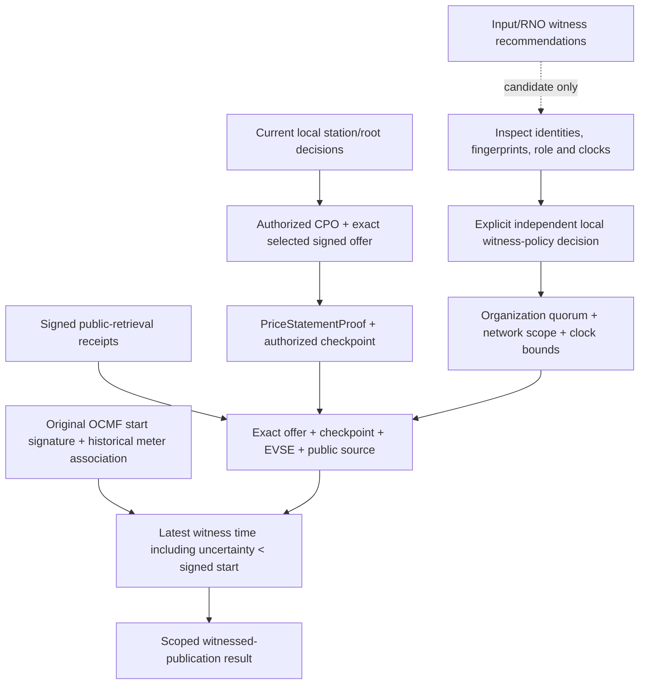
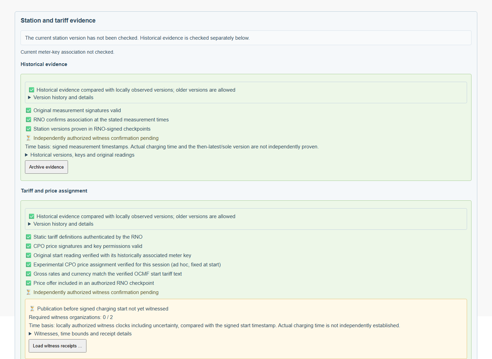
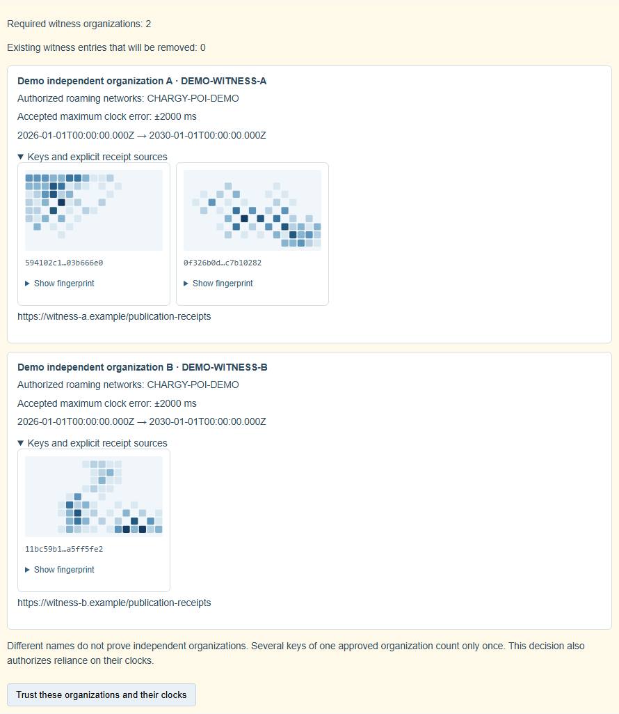
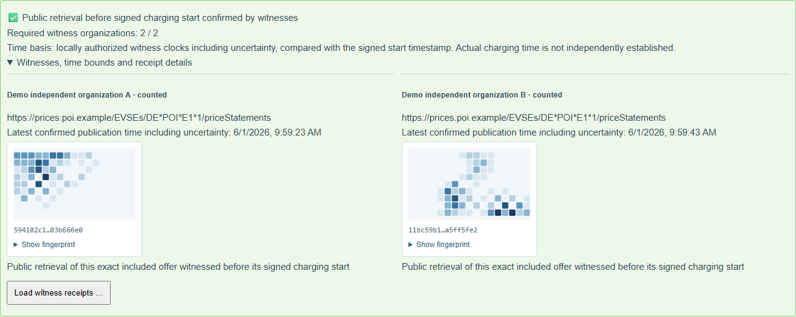
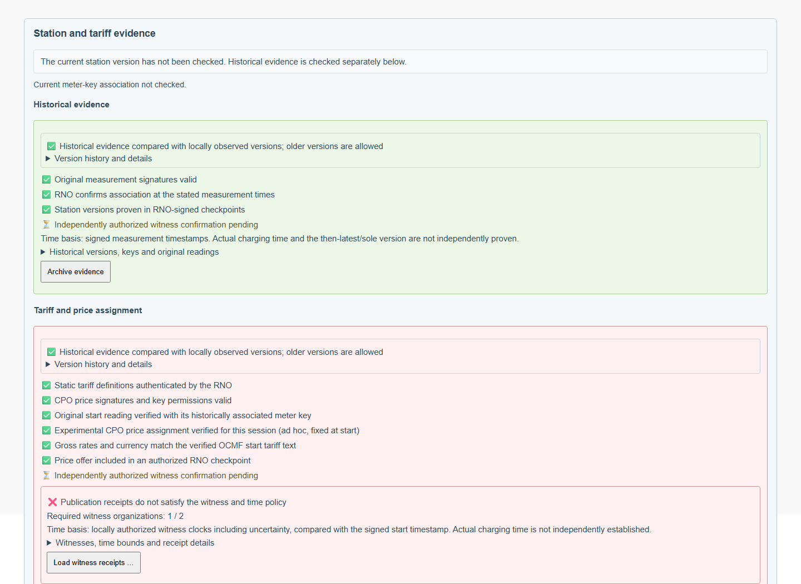
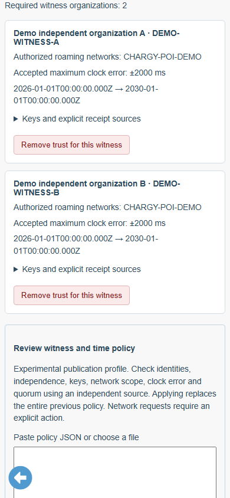
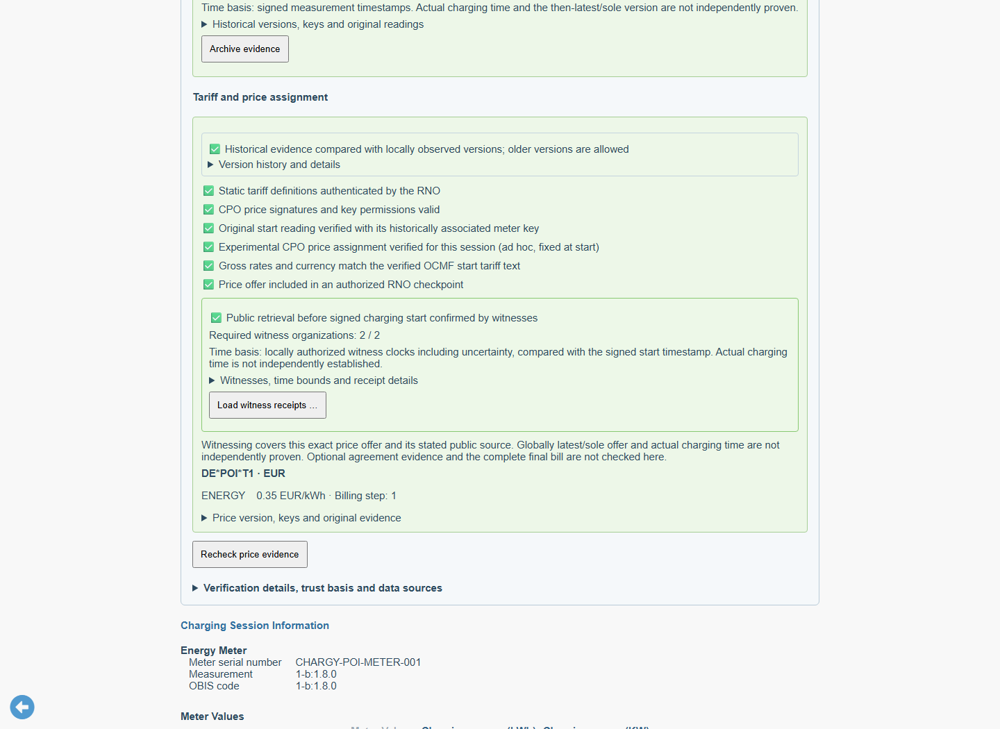

# Witnessed price publication before a signed charging start

Status: 2 November 2026. The mobile port uses the published npm releases
WWCP POI **0.2.0** and ChargyCore **0.18.0**. Package integrity is recorded in
package-lock.json; no development tarballs are required. See the
[mobile integration and verification guide](WWCP-POI-Mobile-Port.md).
This document distinguishes implemented flows from remaining proposals.

The existing price verifier establishes CPO signatures, exact session-price
selection, start-rate consistency and inclusion in an authorized RNO checkpoint.
Those facts alone do not prove that the offer was publicly available before
charging began. A witness signature on a checkpoint does not itself timestamp
the witness's public retrieval. The checkpoint's creation time is an RNO claim.

## The precise additional claim

Chargy displays **Public retrieval before signed charging start confirmed by
witnesses** when its current, separately authorized organization quorum has
signed valid receipts for the exact selected offer, complete tariff definition
including its currency, original CPO signature and authorized checkpoint.
Each receipt asserts actual retrieval from the named public source. It is more
specific than proof that a hash existed at a time: [RFC 3161](https://www.rfc-editor.org/rfc/rfc3161.html#section-1)
defines timestamping as evidence of existence; a timestamp alone does not assert
public availability. This pilot does not implement RFC 3161 tokens.

The time comparison is against the **verified original meter document's signed
start timestamp**. Actual physical charging time is not independently established.
Witness clock accuracy and organizational independence are explicit local trust
assumptions; a signature does not measure either. The claim does not establish
continuous availability, the globally latest/sole offer, customer agreement or
the final bill. Customer agreement remains the separate deferred
[optional OCCApp integration](WWCP-POI-Session-Prices.md#future-todo-optional-evidence-of-agreement-to-a-specific-price-offer).



## Local organization and time policy

Under **Settings → Trust Management → Publication witnesses**, paste a policy or
choose its JSON file, review every entry, then explicitly accept it. Review grants
no trust. The action replaces the whole previous policy and identifies entries
that will be removed. Each witness can subsequently be removed independently;
removal never lowers the configured organization quorum. Missing quorum remains
visible while the existing station, CPO-price and meter checks stay available.

The build source is [`src/trust/publication-witness-policy.json`](../src/trust/publication-witness-policy.json).
It deliberately contains an empty witness list and a two-organization requirement.
Explicit user decisions live separately in IndexedDB `ChargyPOIWitnessTrust`,
store `configuration`. They do not authorize an RNO, CPO or meter key. Policy
updates compare the reviewed revision atomically; quota, blocked/unavailable or
corrupt storage cannot silently grant trust or fall back to memory. A successful
change cancels current views and invalidates other tabs. Every receipt check and
asynchronous completion rechecks the current witness-policy revision.

The following JSON is abbreviated; the
[complete public fixture policy](../tests/fixtures/POIPublication/witness-policy.json)
contains real public keys. Two keys of organization A and one key of organization
B still represent a **2/2 organization quorum**.

```json
{
  "@context": "https://open.charging.cloud/contexts/wwcp/witnessPublicationPolicy/v1",
  "requiredOrganizations": 2,
  "witnesses": [
    {
      "id": "DEMO-WITNESS-A",
      "organization": "Demo independent organization A",
      "role": "price-publication-and-time",
      "networks": ["CHARGY-POI-DEMO"],
      "keys": ["complete POI public key objects"],
      "notBefore": "2026-01-01T00:00:00.000Z",
      "notAfter": "2030-01-01T00:00:00.000Z",
      "clockErrorMs": 2000,
      "endpoints": ["https://witness-a.example/publication-receipts"]
    }
  ]
}
```

Organization identifiers are independently approved identities, not a count of
names asserted by a downloaded list. Several aliases/keys of the same approved
organization count once; the same key material cannot represent two organizations.
Known RNO/CPO identity and operational key material cannot count as independent
publication witnesses, even when relabeled. Other organizational affiliations
cannot be detected cryptographically and must be assessed before authorization.
Existing POI key-usage restrictions are honored: the experimental usage is
`witnessPublications`; an unrestricted key retains its existing broad meaning.

Incoming `witnessCandidates` are shown as untrusted recommendations with
fingerprints and a reviewable policy template. They are never automatically
installed. No implicit trust is gained from an RNO recommendation, HTTPS, a
well-known name, an embedded key, or an archive's audit metadata.





## Signed publication receipt

`SessionPriceEvidence` now optionally carries `publicationReceipts` and
`witnessCandidates`. Existing envelopes remain valid without either field.
Receipts can accompany an embedded completed session, a live link, a source
response or an exported evidence archive. They need no customer/session identity:
the session-price assignment separately selects this exact offer for the session.
Reusing a receipt for a later session that selects the same offer is intentional;
substituting a different EVSE, network, offer or checkpoint is not.

```json
{
  "@context": "https://open.charging.cloud/contexts/wwcp/pricePublicationReceipt/v1",
  "assertion": "public-price-retrieval",
  "roamingNetworkId": "CHARGY-POI-DEMO",
  "EVSEId": "DE*POI*E1*1",
  "priceStatementDigest": "exact selected PriceStatement SHA-256 digest",
  "priceStatementSHA256": "SHA-256 of canonical original PriceStatement including its signature value",
  "tariffSHA256": "SHA-256 of the canonical complete selected tariff including currency",
  "checkpointId": "exact authorized checkpoint containing that price",
  "witnessId": "DEMO-WITNESS-A",
  "publicSourceURL": "https://prices.poi.example/EVSEs/DE*POI*E1*1/priceStatements",
  "observedAt": "2026-06-01T09:59:20.000Z",
  "signedAt": "2026-06-01T09:59:21.000Z",
  "algorithm": "Ed25519",
  "keyId": "authorized witness public key ID",
  "value": "Base64 signature"
}
```

This illustration is not a signed fixture. The complete
[drag-and-drop example](../tests/fixtures/POIPublication/session-before-start.chargy)
contains genuine Ed25519 and ML-DSA-65 receipts. The signature covers canonical
POI JSON of every field except `value`, including the context, assertion,
algorithm, key ID and public source URL. The receipt must be signed within one
minute after observation. The witness descriptor and signing key must cover
the complete accepted uncertainty interval and signing time.

The ordinary POI `priceStatementDigest` omits the signature value by design, so
equivalent valid signatures share the same statement identity. The additional
`priceStatementSHA256` binds the actual CPO signature that was publicly retrieved;
an unsigned draft cannot later be upgraded silently. `tariffSHA256` binds the
complete selected tariff and its currency, rather than only a mutable tariff ID.
The named public source must make that complete price/tariff context available.
Equivalent alternate signature encodings need a receipt for their own original
signed object in this conservative pilot.

For a witness with locally accepted uncertainty `epsilon`, the conservative
comparison is:

```text
earliest observation = observedAt - epsilon
latest publication/signing bound = signedAt + epsilon
required: latest bound < verified signed chargingStarted
```

Equality or overlap cannot establish the claim. Both observation and signing
must be covered by the local validity interval and public key. The checkpoint
and price must already exist according to their declared times, and the exact
checkpoint must have passed RNO authorization and price inclusion. A later
checkpoint cannot be backdated by an earlier asserted receipt. Missing,
untrusted, late and mathematically invalid receipts remain distinct in details.
An invalid extra receipt does not cancel a quorum of other valid independent
receipts; it remains visible in the diagnostics.






## Explicit receipt retrieval and evidence retention

The **Load witness receipts …** button uses only explicitly configured endpoints
of locally authorized witnesses for the selected network. No request is made on
import, policy review, or receipt inspection. The experimental GET contract adds
six public query parameters to each explicit endpoint:

```text
roamingNetworkId, EVSEId, priceStatementDigest, priceStatementSHA256,
tariffSHA256, checkpointId
```

Responses may contain one receipt, an array, or a `publicationReceipts` array.
The app transmits no customer identity, session ID, meter document or signed
start time. It applies public HTTPS/transport rules, omits credentials/referrers,
refuses redirects, bounds requests to 16, responses to 1 MiB each and the total
transfer to 4 MiB, with 15 seconds per source and 30 seconds overall. The complete
price envelope is bounded to 4 MiB. No source failure reduces the quorum.
Witness services must support this experimental contract; endpoint paths are
explicit configuration, never guessed from the RNO or a naming convention.

New receipts are deduplicated and checked against the original selected price,
historical meter association, current root decisions and current witness policy
before adoption. Failure retains the prior evidence. Receipt enrichment does not
change the fixed price or produce a false live-price-change warning. Existing
unsigned recommendations cannot alter the selected offer.

Exports/archives retain the original signed receipt objects as part of the price
evidence. Opening them rechecks current local decisions; it restores no witness
permissions. Local witness removal preserves original evidence and price/station
observations but withdraws the independent publication claim, including after
reload or opening an archive. The pilot's cumulative live flow retains the
selected fixed price and its publication receipts through completion.






## Reproducibility and remaining boundaries

See the [fixture guide](../tests/fixtures/POIPublication/README.md). Run:

```sh
npm run fixtures:poi-publication:generate
npm test -- tests/pricePublication.test.ts
npm run docs:screenshots:poi-publication
```

The browser suite uses real cryptography, actual local decisions, native
IndexedDB, explicit network actions and current authorization after reload,
archive reopening and cross-tab withdrawal. It checks storage failure, late,
uncertainty-overlap, duplicate-organization and tampered receipts. Never inject
positive verdicts or add these public fixture keys to production trust roots.
Regenerate and visually review all eight captures and metadata whenever these
trust, retrieval or price/live flows change; CI also captures them as artifacts.

A real witness must actually retrieve publicly accessible prices and validate
the relevant history before making its assertion. Its clock, key protection and
independent governance remain service-assurance requirements. Producer agreement,
production deployment, independently attested actual meter time, witness
revocation/succession and a signed automatic discovery directory remain further
work. This extension does not provide these by inventing implicit trust.
