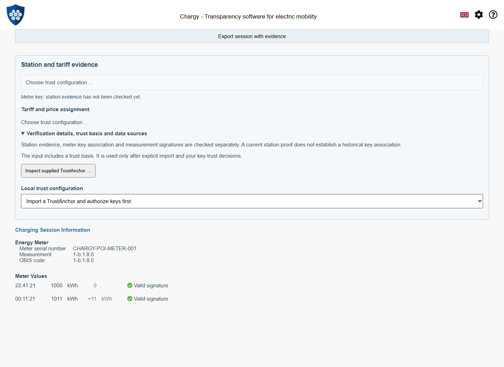
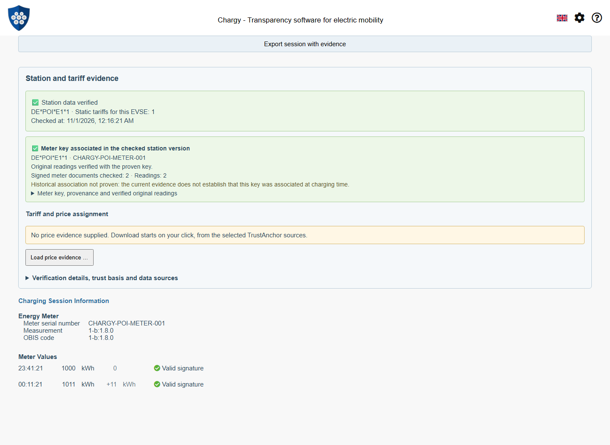
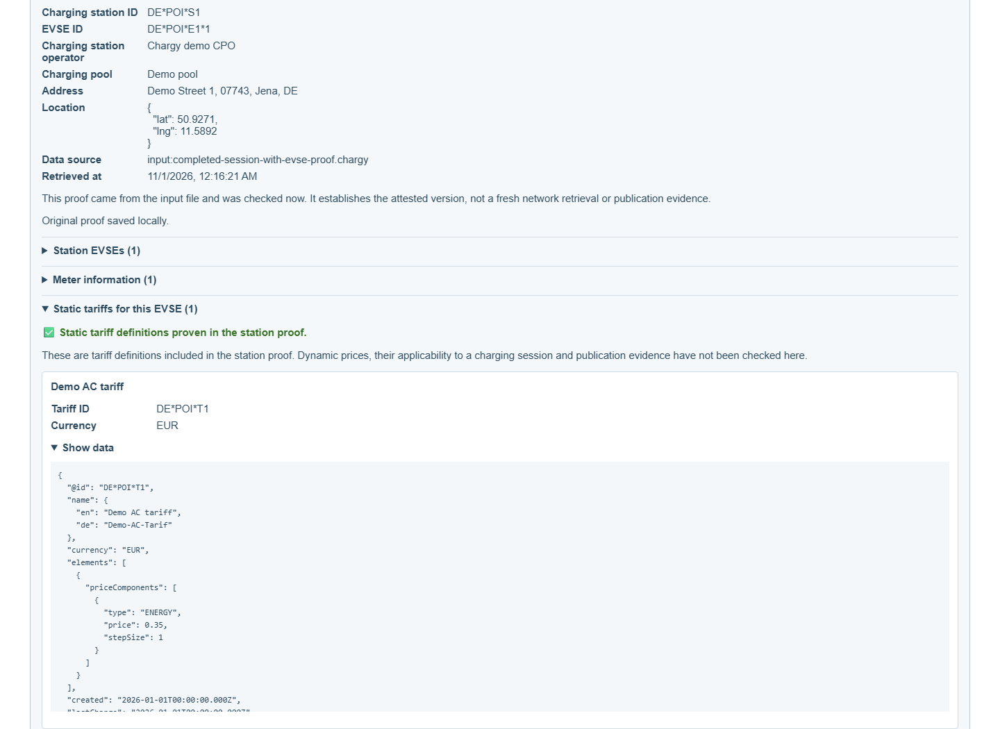
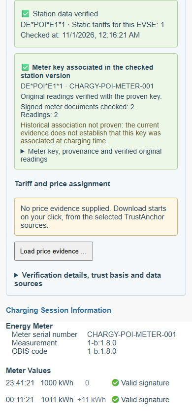

# Session-Bound Station and Static Tariff Evidence

Status: 2 November 2026. The mobile port uses the published npm releases
WWCP POI **0.2.0** and ChargyCore **0.18.0**. Package integrity is recorded in
package-lock.json; no development tarballs are required. See the
[mobile integration and verification guide](WWCP-POI-Mobile-Port.md).
This document distinguishes implemented flows from remaining proposals.

✅ The charging-session details now contain **Station and tariff evidence**.
The session's EVSE is fixed for this check; the user selects one saved local
trust configuration. A supplied proof is verified automatically when one
unambiguous authorized configuration matches. Without a supplied proof, the
details offer an explicit fresh request for that EVSE. No station directory is
downloaded and an EVSE prefix never selects a trusted operator.

## Drag & Drop: one complete, matching example

Use [completed-session-with-evse-proof.chargy](../tests/fixtures/POISession/completed-session-with-evse-proof.chargy).
The [fixture README](../tests/fixtures/POISession/README.md) documents the full
workflow, public test keys, provenance and regeneration. It is a completed
30-minute session with separate signed start/end readings, 11 kWh consumption,
the corresponding meter and EVSE, and a static EUR 0.35/kWh tariff included in
a real pruned Merkle proof.



ChargyCore checks the original OCMF signatures with the container's supplied
key. POI trust remains a separate decision: the file cannot authorize itself.
The embedded TrustAnchor is displayed first; explicit Import checks the supplied
KeyStatement without a network request. The user then explicitly accepts keys
for both holders. The UI labels the statement as supplied by the input file and
labels its source URL as declared, rather than claiming a network download.



The station status stays visible while controls, sources and detailed data are
collapsed. Green applies to the attested station version and checked EVSE;
warnings, verification errors and pending results remain distinct. Measurement
signature verification and POI-based meter-key authorization are separate claims.
The additional meter-key result now rechecks the original readings with the
explicitly associated EVSE key. It exposes source-key conflicts, gives access to
the newly checked readings' crypto details and keeps historical association
explicitly unproven. The original Core/container verdict remains separate.
Changing an OCMF end reading fails its own signature while the unchanged station
proof can still pass. Altering the station data fails the station proof while
the original OCMF signatures can remain mathematically valid.



Static tariff definitions are inspectable with a qualified inclusion check.
This does not establish dynamic prices, billing applicability or independently
witnessed publication. The example's tariff amount matches both signed OCMF
tariff texts. The separate [price fixture](WWCP-POI-Session-Prices.md) now
implements a qualified experimental fixed-at-start comparison; full billing
evaluation remains future work.



The session summary and details stack on narrow screens. The map is hidden there
to leave room for the evidence and readings; the normal desktop layout is retained.


## Input structure and association

The optional app-level `poiEvidence` extension is read from original JSON using
the lossless WWCP parser before Core converts the measurement container. Its
version-1 envelope is:

```json
{
  "poiEvidence": {
    "@context": "https://open.charging.cloud/contexts/chargy/poiEvidence/v1",
    "EVSEId": "DE*POI*E1*1",
    "roamingNetworkId": "CHARGY-POI-DEMO",
    "bootstrap": {
      "trustAnchor": "<compact WWCP/TA-2 anchor>",
      "keyStatement": "<original signed operator/KeyStatement JSON text>"
    },
    "chargingStationProof": "<original ChargingStationProof JSON text>"
  }
}
```

The placeholders illustrate structure; the linked fixture contains the complete
real signed JSON objects. JSON objects and original JSON strings are accepted
for the statement/proof. Embedded objects are serialized losslessly for
standalone verification; JSON strings retain their original text. Exports use
strings to preserve signed decimal values.
`bootstrap`, `chargingStationProof` and the network hint are optional. In a
multi-session record an explicit `sessionId` must match the selected session;
an ID-less association is accepted only for a single-session input. Multiple
competing matches and contradictory EVSE identities are errors, never a reason
to pick the first proof or search for a key that happens to validate.

```mermaid
sequenceDiagram
    actor User
    participant App
    participant Core as ChargyCore
    participant Local as Local trust decisions
    participant POI as Shared POI verifier
    User->>App: Drop completed session + poiEvidence
    App->>Core: Original container / original signed OCMF
    Core-->>App: Measurement signature results and session EVSE
    App->>Local: Read saved policies and current authorization
    opt Supplied bootstrap not yet authorized
        User->>App: Inspect anchor; Import supplied statement
        App->>POI: Check statement signatures, pins and validity
        User->>Local: Explicitly authorize individual holder keys
    end
    App->>POI: Fresh TrustContext + proof + selected session EVSE
    POI-->>App: Station version, dependencies, warnings or failure
    App->>POI: Reverify proof; bind exact EVSE/meter and normalize its key
    POI-->>App: Current key association and provenance
    App->>Core: Original OCMF + authorized key binding
    Core-->>App: Signatures, signed identity and source-key conflicts
    App->>Local: Reread authorization after asynchronous checks
    App-->>User: Separate measurement and station/tariff results
```

Original session input and signed measurement payloads are not rewritten to
insert keys or station data. The POI result uses a separate panel. The selected
policy cannot be silently replaced by an embedded anchor. Same-ID networks or
multiple candidate policies are not merged. Explicit refresh uses the existing
bounded proof transport; supplied-proof verification itself makes no POI request.

Live links can show this panel before readings exist. Same-session, same-EVSE
live updates may retain the preceding supplied evidence when no new evidence
is supplied; verification is repeated against current decisions/time. A changed
identity cannot inherit it. The shared APIs now prepare a current key before
readings exist and check a single signed start reading. A complete matching live
series and update/replay policy are now implemented in the
[live pilot](WWCP-POI-Live-Pilot.md), with a separate
[persistent observed-version journal](WWCP-POI-Observed-Versions.md).

## Storage, freshness and remaining work

Supplied statements and proofs retain `origin: "embedded"`. Proof sources use
`input:<filename>`; a statement's URL is the anchor's declared endpoint, explicitly
distinguished from retrieval. Existing schema-version-2 records remain compatible.
The policy-scoped proof cache still stores original proof text and provenance,
never a reusable green authorization flag. Export preserves single-entry POI
evidence; cache deletion and current-time rechecking follow the existing rules.

The normal app rejects expired fixture attestations. Regeneration signs new
documents; screenshot tests alone fix their clock to `provenance.generatedAt`.
This current-only path does not prove which station version was published
before the charging session. The separate
[historical path](WWCP-POI-Historical-Sessions.md) checks attested signed-reading
times and checkpoint inclusion, and retains audit-only policy snapshots without
restoring them as trust.

✅ Shared-library meter-key selection and an additive Core verification API are
implemented for explicit uncompressed P-256/OCMF inputs. They enforce signed
EVSE/meter identity, key identity and current observation time, without trying
unrelated keys. The [handoff guide](WWCP-POI-Meter-Key-Handoff.md) covers the
result contract and genuine counterexamples. Historical session archives and
experimental fixed-at-start CPO prices are now implemented separately. EMP
offers, independent witnesses and full billing evaluation remain future work.

## Verification and screenshot maintenance

`tests/sessionPOI.test.ts` checks actual Core parsing and both measurement
signatures, fixture provenance, matching meter key, real station/tariff inclusion,
unknown trust, wrong EVSE, competing evidence and decimal-preserving export.
`tests/sessionMeterKeys.test.ts` additionally checks shared association and actual
Core re-verification, wrong/ambiguous meters, source-key conflicts, invalid
signatures, trust withdrawal and a single start reading.
The browser script exercises real Drag & Drop, file selection/reload, explicit
offline bootstrap import, two-holder trust, static tariffs, fresh retrieval,
tampering, expiry, the original measurement-signature detail dialog and
desktop/mobile rendering. It also checks the key counterexamples, conflict-
preserving export/reimport and trust withdrawal during real asynchronous crypto.
It never injects green outcomes.

Run `npm run docs:screenshots:poi-session` whenever this UI, association or import
flow changes. Inspect **all** captures, update captions and include the new
[capture metadata](screenshots/poi-completed-session/capture-info.json). CI runs
the browser checks and publishes fresh captures as an artifact.

The [session price evidence guide](WWCP-POI-Session-Prices.md) describes the implemented CPO-signed
price workflow, experimental fixed-at-start assignment, exact start-rate
comparison and separate price inclusion, with signed examples and screenshots.
Customer consent, pre-charge publication and full billing remain unproven.
