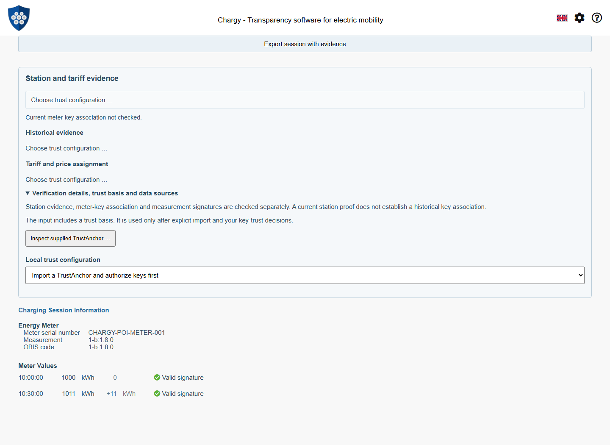
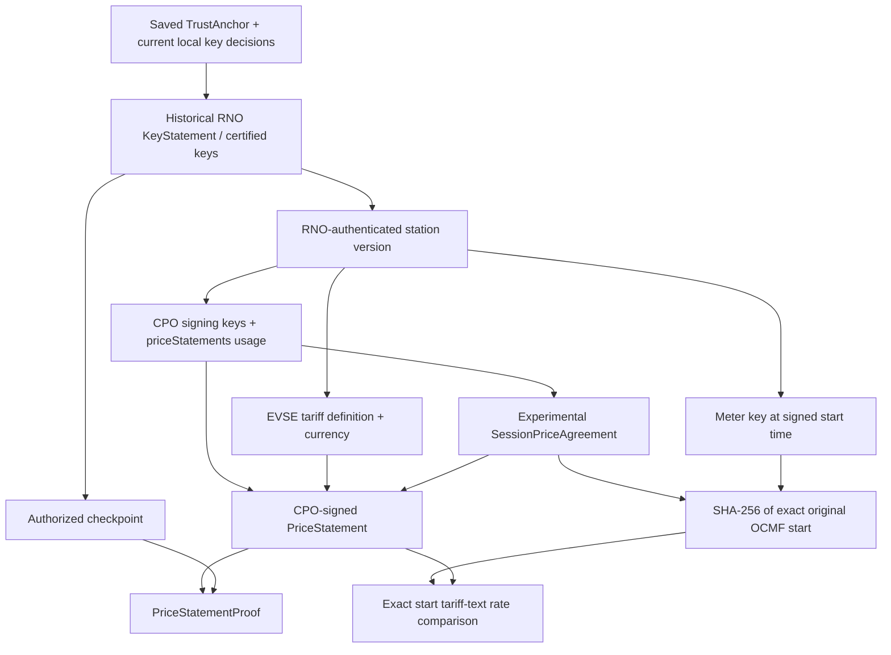
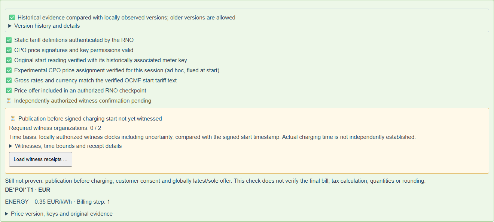
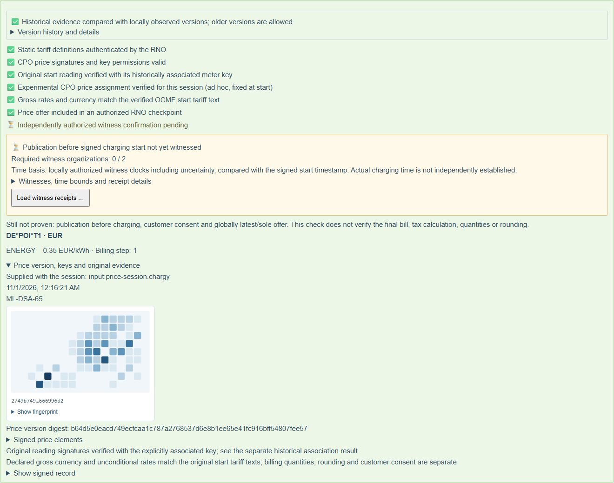
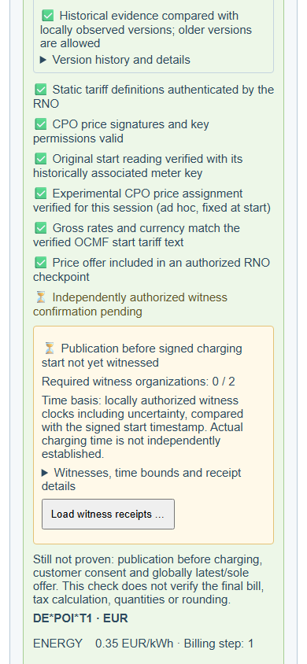
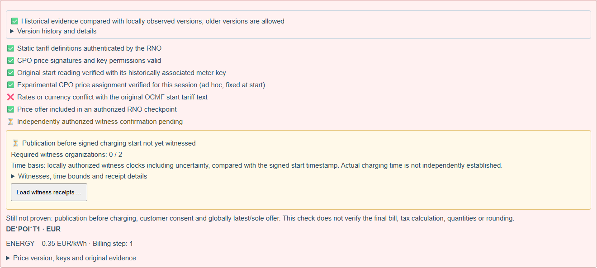
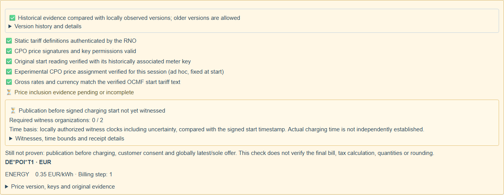

# WWCP POI: Session-bound Tariffs and Price Evidence

Status: 2 November 2026. The mobile port uses the published npm releases
WWCP POI **0.2.0** and ChargyCore **0.18.0**. Package integrity is recorded in
package-lock.json; no development tarballs are required. See the
[mobile integration and verification guide](WWCP-POI-Mobile-Port.md).
This document distinguishes implemented flows from remaining proposals.

The [historical session workflow](WWCP-POI-Historical-Sessions.md) already checks
the original meter readings and their RNO-attested key associations. This step
adds CPO-signed prices, an explicit selection of the price for the session,
consistency with its OCMF start tariff text, and separate checkpoint inclusion.

## What is checked

| Claim | Evidence and result |
| --- | --- |
| Static tariff definition and EVSE references | RNO-authenticated station proof at the original signed start timestamp |
| CPO price authority | Genuine signature, responsible CPO, certified signing key, `priceStatements` usage and validity at signing |
| Applicable offered price | Correct network and entity scope, EVSE-referenced tariff, validity at start, consistent supplied sequence/previous links |
| Selected price for this session | Experimental CPO-signed assignment of the exact original start document, EVSE, meter, start time, tariff, price digest, mode and binding profile |
| Start meter reading | Original OCMF signature with the historically associated meter key, independently of whether an end reading exists |
| OCMF rate consistency | Exact decimal comparison of currency and unconditional gross rates in the verified start tariff text |
| Price checkpoint inclusion | `PriceStatementProof`, its embedded CPO signature, matching Merkle root, authorized RNO checkpoint signatures and any supplied checkpoint links |
| Independent witnesses | Only caller-authorized witnesses count; names or public keys included by the source do not authorize themselves |
| Public retrieval before signed start | Experimental signed publication receipts under a separately accepted organization, network and clock policy; [implementation and limitations](WWCP-POI-Price-Publication.md) |

The CPO price and assignment verifiers use the shared POI signature dispatcher.
The fixtures exercise **Ed25519 and ML-DSA-65**. This does not widen the separate
P-256/OCMF meter-key pilot.

The app never guesses precedence between a pool, station and EVSE offer. A
signed assignment must select one exact price digest and tariff. Without it,
even one valid offer remains **unbound**; competing offers remain ambiguous.
An empty response is missing evidence, not a successful price check.

## User flow and network access

```mermaid
sequenceDiagram
    participant User
    participant App as Chargy
    participant Local as Local trust and evidence
    participant Source as Selected TrustAnchor source
    participant Core as ChargyCore
    User->>App: Drop completed session / open session
    App->>Local: Read current anchor and local key decisions
    alt Unknown or insufficiently trusted anchor
        App-->>User: Inspect supplied anchor; explicit key decisions
    end
    App->>Core: Reparse original OCMF start document
    Core-->>App: EVSE, meter, signed start time, SHA-256 (not yet verified)
    alt Price evidence already supplied
        App->>App: Verify original supplied price envelope locally
    else Price evidence missing
        App-->>User: Load price evidence …
        User->>App: Explicit download
        App->>Source: GET /EVSEs/{id}/priceStatements
        Source-->>App: Signed prices or experimental full envelope
        App->>App: Verify before accepting this mirror
    end
    App->>Core: Verify exact start with historically associated key
    App->>App: Check CPO assignment, price sequence, rates, inclusion
    App->>Local: Re-read current authorization after crypto
    App-->>User: Separate checks, qualified result and drill-down details
    User->>App: Archive evidence
    App->>Local: Original session + price JSON + audit-only provenance
```

Embedded evidence is checked without a POI request. A saved, fixed-at-start price
is not replaced by today's offer on recheck. The download button uses only the
selected saved TrustAnchor's source URLs, with the existing public HTTPS rules,
no credentials or redirects, a 2 MiB response limit, 15 seconds per source and
30 seconds for the entire operation. A failed or unusable source permits the
next authorized mirror; transport access never establishes data authenticity.
Clearing the policy, changing sessions or leaving the view cancels pending work.

A source may relay CPO-signed objects; it need not be the CPO. The source's
authority comes from verified signatures and inclusion, rather than from a
claim made by its HTTP response. Automatic witness-directory discovery remains
future work. Explicit local witness/time management and publication receipts are
now implemented in the [publication pilot](WWCP-POI-Price-Publication.md).
The app does not trust a witness list simply because the RNO supplied it.

The endpoint can return a plain price array, a `priceStatements` wrapper, or the
experimental full envelope below. A plain array is combined with the supplied
station proof and cannot establish an absent session assignment or checkpoint.
If the source cannot supply evidence applicable to an old session, the result
remains missing, invalid or unbound. No historical server lookup contract is
invented, and the app does not fall back to a current price as the agreed price.



The fixture's public test keys are not production trust roots. They require
explicit local acceptance before any price authorization can succeed.

## Data structures and signatures



The following price and assignment are taken from the public Ed25519 fixture.
Only signature values are replaced with explanatory placeholders; these snippets
are for reading. Use the complete `.chargy` fixtures for verification.

### CPO price offer

```json
{
  "@context": "https://open.charging.cloud/contexts/wwcp/roamingNetwork/priceStatement/v1",
  "roamingNetworkId": "CHARGY-POI-DEMO",
  "entityType": "EVSE",
  "entityId": "DE*POI*E1*1",
  "priceStatus": {
    "prices": [{
      "chargingTariffId": "DE*POI*T1",
      "elements": [{
        "priceComponents": [{ "type": "ENERGY", "price": 0.35, "stepSize": 1 }]
      }]
    }]
  },
  "validFrom": "2026-06-01T09:59:00.000Z",
  "validUntil": "2026-06-01T10:05:00.000Z",
  "sequence": 0,
  "role": "chargingStationOperator",
  "signer": "DE*POI",
  "signedAt": "2026-06-01T09:55:00.000Z",
  "algorithm": "Ed25519",
  "keyId": "d423a82879e62cfb33fc10d72b218b28b5656053233a9cd125952bd32053d393",
  "value": "<base64 CPO signature>"
}
```

The price digest is SHA-256 of the canonical signature input, excluding `value`,
as specified by `PriceStatement`. It is independent of equivalent signature
encodings. Lossless JSON parsing preserves signed decimals such as `0.3500`
through verification, rendering, archive and export.

### Experimental session price assignment

```json
{
  "@context": "https://open.charging.cloud/contexts/wwcp/sessionPriceAgreement/v1",
  "roamingNetworkId": "CHARGY-POI-DEMO",
  "EVSEId": "DE*POI*E1*1",
  "meterSerialNumber": "CHARGY-POI-METER-001",
  "chargingStarted": "2026-06-01T10:00:00.000Z",
  "startDocumentSHA256": "4be192ab50f9b56440268de9d9b6c87c6745892bd2aadd3e3a891596787c34f4",
  "chargingMode": "adhoc",
  "chargingTariffId": "DE*POI*T1",
  "priceStatementDigest": "e3581482ba56a562f612a0f70fa08be468e32d74bed90072d6f4e55a746259ac",
  "priceBinding": "fixed-at-start",
  "pricingProfile": "chargy-gross-rates/v1",
  "role": "chargingStationOperator",
  "signer": "DE*POI",
  "signedAt": "2026-06-01T10:01:00.000Z",
  "algorithm": "Ed25519",
  "keyId": "d423a82879e62cfb33fc10d72b218b28b5656053233a9cd125952bd32053d393",
  "value": "<base64 CPO signature>"
}
```

The signature covers canonical JSON with `value` removed. The start digest
covers the UTF-8 bytes of the **entire exact original OCMF start document**,
including its signature. Reserializing that document changes the subject and
requires a matching assignment. Cached parsed payloads, displayed timestamps
and imported validation flags cannot substitute for those original bytes.

This assignment was deliberately signed **after** charging started. It is a
CPO confirmation, not proof of an offer accepted beforehand. Both its signature
time and start time must be covered by the authorized CPO key's validity.

For `fixed-at-start`, the offer must be active at the original start. In this
fixture it expires after five minutes, while charging continues for thirty
minutes. Its expiry does not silently replace the selected price during that
session. Variable prices and contractual/EMP assignments require additional
profiles and remain explicitly unsupported.

### Evidence envelope and portable session

The experimental envelope has this shape. Angle-bracket strings stand for
complete structured objects, not literal values accepted by the parser:

```json
{
  "@context": "https://open.charging.cloud/contexts/wwcp/sessionPriceEvidence/v1",
  "EVSEId": "DE*POI*E1*1",
  "chargingStationProof": "<complete station proof object>",
  "priceStatements": ["<complete CPO-signed PriceStatement object>"],
  "agreement": "<complete experimental SessionPriceAgreement object>",
  "priceStatementProofs": ["<complete PriceStatementProof object>"],
  "checkpoints": [{
    "checkpoint": "<complete signed checkpoint object>",
    "operator": "<RNO operator with KeyStatement and certified keys>"
  }]
}
```

`agreement`, `priceStatementProofs` and `checkpoints` may be absent; their absence
does not grant the claims they would establish. `chargingStationProof` is
required. The proof needs to apply at the start timestamp, not just today.

The normal Chargy session's `poiEvidence.priceEvidence` accepts this object or
its original JSON text. Normal export uses JSON **text** to prevent an ordinary
JSON serializer from rounding signed decimal tokens. Existing
`historicalEvidence`, original OCMF documents and public bootstrap references
remain alongside it. Unknown extension fields are not interpreted as authority.

## Qualified display and drill-down



The green field confirms the listed scoped checks. It always states that
pre-charge publication, customer consent and globally latest/sole status are
not proven. A valid checkpoint recorded on 2 June does not prove that a price
was publicly available before charging on 1 June. A missing price proof stays
pending even when the CPO assignment and meter signature are valid. Related
station and price checkpoints at the same epoch/sequence must not conflict;
supplied `after` links require their checkpoint line. Supplied price-chain gaps
are visible. The [persistent observed-version journal](WWCP-POI-Observed-Versions.md)
also detects contradictions across packets, tabs and reloads. Historical session
prices may be older than current offers; global completeness/latest status is
not inferred from local consistency.



Details expose the CPO algorithm, visual key fingerprint, price digest, exact
elements, source and receipt time, diagnostics and original evidence. A
fingerprint helps compare a key; its image does not grant trust.



The experimental `chargy-gross-rates/v1` profile defines unconditional gross
rates: ENERGY per kWh, TIME per hour and FLAT once. Only one unconditional
element with at most one component of each supported type is projected to the
OCMF comparison. Currency and raw decimal cents are compared exactly using the
known Bonn tariff-text profiles. Restrictions, blocking/parking conditions,
VAT fields, unknown pricing profiles and duplicate components are not silently
discarded. Component step sizes remain visible; quantity, step, tax, rounding
and final-invoice calculation are **not** verified by this rate comparison.



A genuine OCMF start tariff of 65 cents and a genuine selected CPO offer of
35 cents produce an explicit conflict. Signature validity alone cannot fix it.



## Storage, trust withdrawal and rechecking

Downloaded evidence stays attached to the current session in memory and normal
session export. Explicit **Archive evidence** stores the original export in the
separate `ChargySessionEvidence` IndexedDB database, alongside an audit-only
policy and source snapshot. The snapshot identifies receipt time and selected
source, and records that time claims use signed measurement timestamps. It
never restores key trust or saved success flags.

Opening an archive reparses the originals and rebuilds authorization from the
current saved anchor/key decisions. Authorization is read again after
asynchronous meter crypto. Withdrawing a required holder during checking must
prevent success. Deleting an anchor retains forensic evidence but removes its
authorization; deleting the archive is a separate action. Export to another
installation carries evidence and public references, not permission to trust
them.

## Reproduce and remaining work

Drag [session-with-price.chargy](../tests/fixtures/POIPrices/session-with-price.chargy)
into Chargy, inspect the supplied anchor and explicitly accept its two public
test holders. Use the fixture evaluation time from
[provenance.json](../tests/fixtures/POIPrices/provenance.json) when reproducing
the exact captures. The [fixture guide](../tests/fixtures/POIPrices/README.md)
lists all 21 signed positive and negative examples.

Run `npm run fixtures:poi-prices:generate` to regenerate public fixtures and
`npm run docs:screenshots:poi-prices` to exercise the real browser flow and
refresh the six images. Screenshots and capture metadata must be regenerated
and visually reviewed when relevant UI/UX changes. CI also regenerates them as
artifacts. No production key list or verification result is modified for a
capture.

Remaining work includes a standardized session-price assignment profile,
EMP/contract offers, variable tariffs and full billing evaluation;
production witness services and independently attested actual charging time; journal backup;
and wider live discovery/transition profiles. Verified compact policy and epoch
succession are now implemented in the
[experimental succession profile](WWCP-POI-Trust-Succession.md).
The [complete cumulative live pilot](WWCP-POI-Live-Pilot.md) now
prepares before the first reading, checks updates before adoption, retains the
verified fixed-at-start price and stops after a verified end. An unbound offer
before the first start does not pin the later actual session selection.

### Future TODO: optional evidence of agreement to a specific price offer

**Deferred; intended producer: OCCApp.** Collecting the customer's agreement is
outside Chargy's current purpose. A charging app could eventually supply a
verifiable receipt that lets Chargy display **"Agreement to the specific price
offer evidenced"** as a separate optional claim. No existing producer integration
or agreed interchange format is assumed by this implementation.

Before implementing this, agree the receipt format and authorization model with
OCCApp. The evidence must identify the exact offer/version, its applicable scope
and the concrete session, and distinguish a customer confirmation from a CPO's
assertion that confirmation occurred. Define privacy-preserving subject binding,
signed timestamps, replay protection and how the confirming app or customer is
authorized; do not invent an accepted protocol or require a customer signing key
without that design. A signed timestamp alone does not establish independent
actual time.

Chargy would verify supplied evidence, retain its original form for later rechecks
and show scoped details. Missing evidence must not invalidate otherwise valid
station, tariff, price-publication or meter-signature checks. This optional future
claim must remain separate from live-request permission, local trust decisions,
CPO-signed price assignments and proof of publication before charging started.
