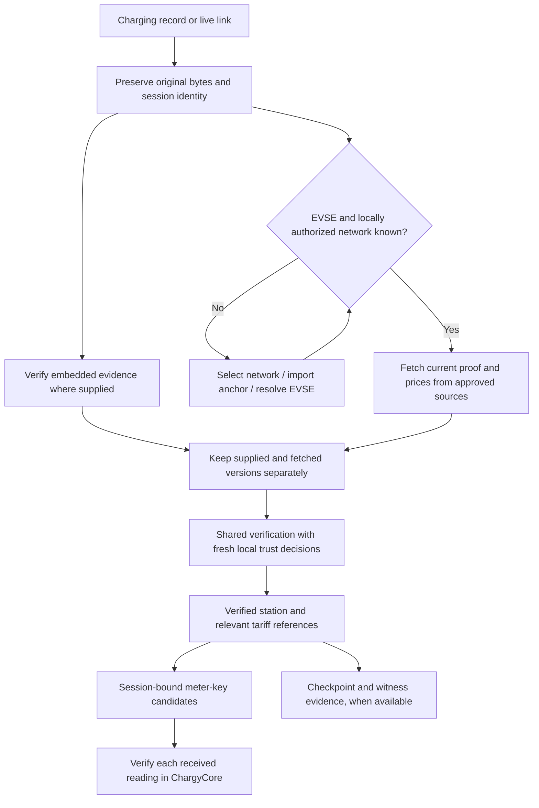
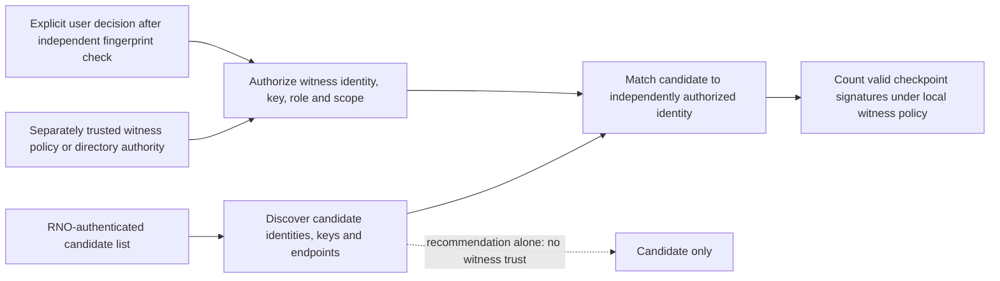
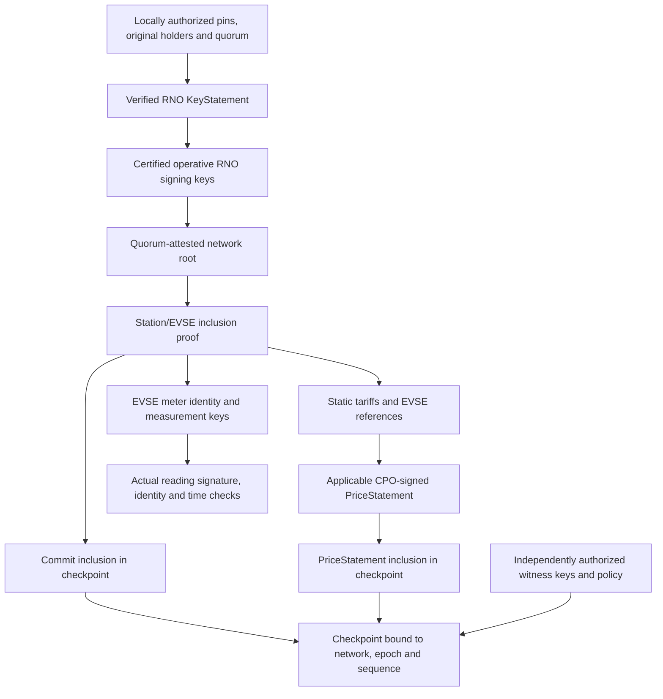
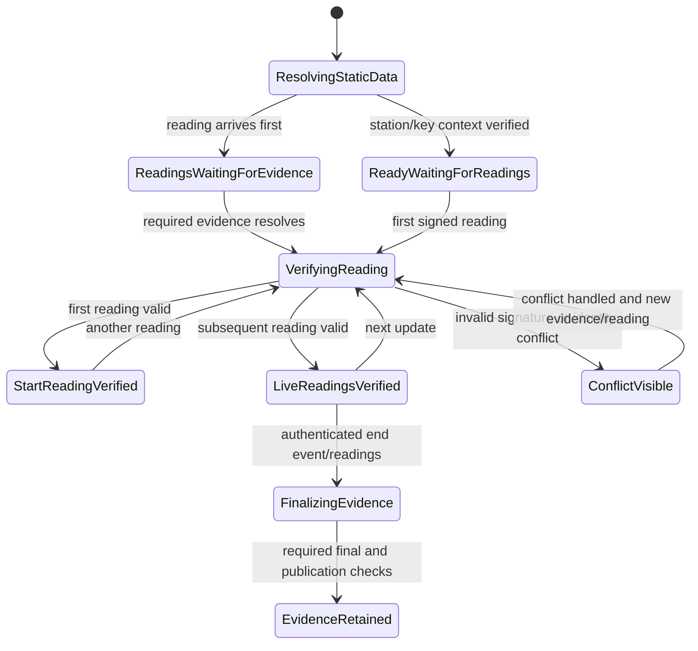
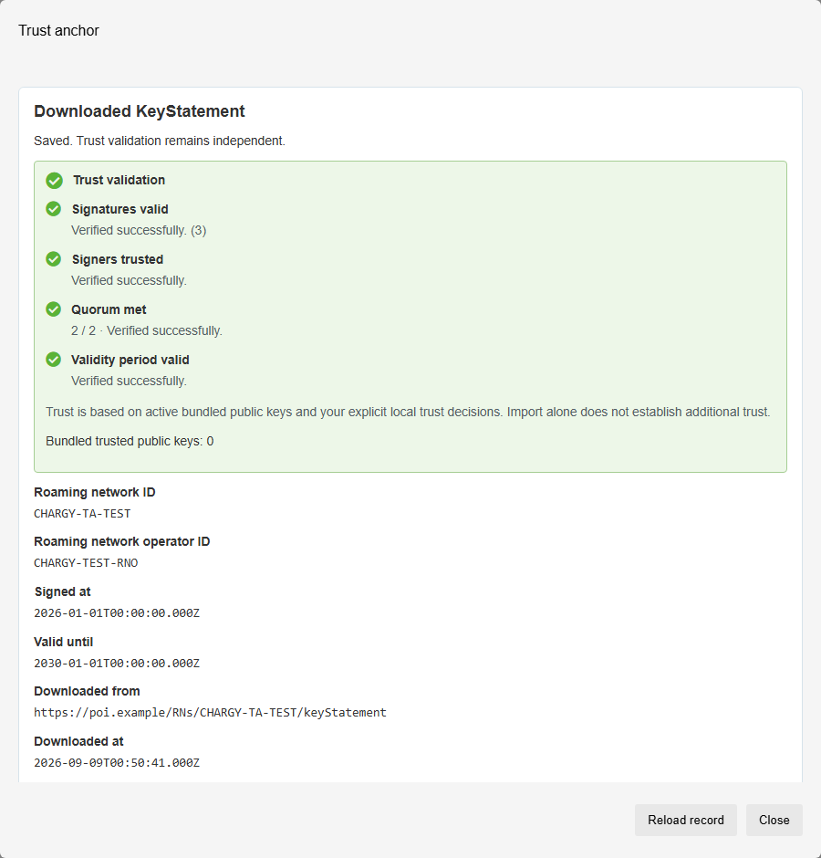
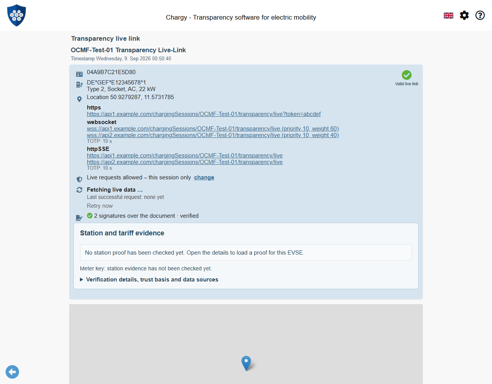
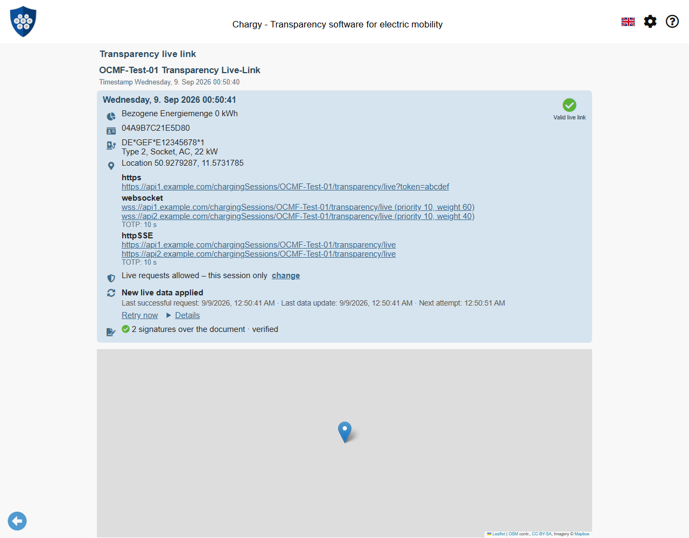

# WWCP/POI Trust Use Case: Charging Sessions and Live Links

Status: 2 November 2026. The mobile port uses the published npm releases
WWCP POI **0.2.0** and ChargyCore **0.18.0**. Package integrity is recorded in
package-lock.json; no development tarballs are required. See the
[mobile integration and verification guide](WWCP-POI-Mobile-Port.md).
This document distinguishes implemented flows from remaining proposals.

Chargy receives a completed charging record or a live link. The input may carry
station and tariff evidence, or only identify an EVSE. Chargy resolves the relevant
roaming network, obtains fresh evidence where possible, verifies it against local
trust decisions and prepares the correct measurement-key context. For a live
session this can happen **before the first meter reading arrives**. Each incoming
reading can then be checked during update processing.

The source of a document, its cryptographic authority and its independent
observation are separate facts. An RNO normally supplies fresh station proofs.
A mirror or witness may deliver the same evidence. A witness adds independent
checkpoint signatures only when Chargy's own policy authorizes that witness.

This document extends the [trust architecture](WWCP-POI-Trust-Architecture.md)
and [integration plan](WWCP-POI-Integration.md). It describes a use case to build,
rather than claiming that the complete workflow already exists.

## 1. Starting point and implementation boundary

| Capability | Current state |
| --- | --- |
| Import TrustAnchors, check KeyStatements, manage local key trust | Implemented |
| Shared `TrustContext`, fresh local authorization snapshots, RN/RNO/policy binding | Implemented in the library and app |
| `POITrustService.verifyStation(...)` | ✅ Manual network/EVSE download, result details and cache/recheck implemented; session-bound display and explicit retrieval now available; fully automatic discovery/refresh remains future work |
| Live link without readings, HTTPS updates and verification of received OCMF readings | Implemented using the existing Core path |
| Automatic discovery and refresh of POI evidence from a session | Proposed here |
| POI-derived meter-key selection and provenance passed to Core | ✅ P-256/OCMF pilot, including single start reading and current-key preparation; [guide](WWCP-POI-Meter-Key-Handoff.md). A complete cumulative live series is now implemented; see the live pilot guide |
| Witness discovery, role-specific trust management and publication status in the app | Proposed here |
| Historical signed-reading-time association, RNO checkpoint inclusion and session archive | ✅ Implemented; [guide](WWCP-POI-Historical-Sessions.md) |
| CPO prices, experimental session selection, start-rate consistency and price inclusion | ✅ Implemented; [guide](WWCP-POI-Session-Prices.md); customer consent and pre-start publication remain unproven |
| Full historical policy/succession, independent time and complete publication evidence | Proposed here |

An input's embedded TrustAnchor, keys or proof URLs are initially hints. They
cannot replace the user's saved trust policy. A valid document signature using a
key embedded in that document is also distinct from authenticating the CPO through
an authorized POI trust chain.

## 2. Inputs and the first decision

Chargy preserves the original input before adding any local results. It extracts
the session identity, EVSE/station identity, claimed charging times, supplied keys
and any embedded evidence. Completed records can contain several sessions;
resolve and verify each session separately.

| Input | Immediate action | Additional retrieval |
| --- | --- | --- |
| Record/live link with station proof and prices | Validate supplied evidence and record its version, scope and time | Refresh the current proof/prices; fetch historical/publication evidence for the relevant session |
| Only an EVSE ID | Select an applicable saved network/policy | Request the EVSE's station proof and applicable prices |
| Station ID with several EVSEs | Resolve the station and identify the actual EVSE | Request a station proof; ask for a focused selection if necessary |
| Missing or contradictory identity | Show what is known; keep readings available with qualified status | Do not guess a station or select an arbitrary key |

An EVSE ID does not identify a unique RNO or a proof server. A station can appear
in several roaming networks. Use an existing session association, a matching
locally authorized network, or a user selection. An input may suggest network IDs
and sources, but each must be matched to a saved policy. Do not derive authority
from an EVSE prefix or silently union the keys of several networks.

If no suitable trust basis exists, offer the existing TrustAnchor import flow.
Mathematical measurement verification may remain available separately. Importing
an unknown anchor still does not establish a trusted quorum.



### Example: an initial live link

The following is a **field excerpt**, not a complete signed document. These are
existing LiveLink fields; the complete signed fixtures are linked in section 11.
There is deliberately no `signedMeterValues` property yet.

```json
{
  "@id": "5f2c8a10-7b64-4e19-9d3a-1c8e05b4a7f2",
  "@context": "https://open.charging.cloud/contexts/chargeTransparency/live/link/1.0",
  "created": "2026-09-09T00:50:40Z",
  "lastUpdated": "2026-09-09T00:50:40Z",
  "chargingStation": {
    "@id": "DE*GEF*S12345678",
    "EVSE": {
      "@id": "DE*GEF*E12345678*1"
    }
  },
  "liveTransports": [
    {
      "type": "https",
      "urls": ["https://api1.example.com/chargingSessions/OCMF-Test-01/transparency/live?token=abcdef"],
      "refresh": 10
    }
  ]
}
```

The token above is a public fixture value. Real live-link tokens, custom headers,
TOTP secrets, contract identifiers and readings must never be forwarded to POI
or witness services just to resolve a public EVSE.

### Embedded proofs and local sidecars

The current LiveLink schema has no agreed POI-evidence extension. New fields in
this document are proposals, not already supported Core or POI wire formats.
Agree an embedding/attachment format with both libraries before implementing it.

Preserve signed POI documents losslessly. POI's decimal-preserving canonical JSON
and a live envelope's declared signing representation are different contracts.
Parsing nested POI numbers as JavaScript floats and serializing them again can
destroy their signatures. Prefer preserved original documents or detached,
content-addressed attachments. Never insert a fetched proof or key into an
already signed live link and then verify the modified envelope.

An **app-owned, proposed** resolution request could look like this. The local
policy ID is obtained from Trust Management, not accepted from the input:

```json
{
  "schema": "urn:chargy:proposal:poi-resolution-request:v0",
  "sessionId": "session-local-42",
  "evseId": "DE*GEF*E1*1",
  "anchorPolicyId": "<selected-local-policy-id>",
  "requestedMode": "current-live",
  "embeddedDocuments": [
    {
      "kind": "chargingStationProof",
      "mediaType": "application/json",
      "originalText": "<unchanged complete signed POI JSON>"
    }
  ]
}
```

## 3. Where does fresh evidence come from?

The default source is a server of the **RoamingNetworkOperator**, reached through
the URLs of the selected saved TrustAnchor. The RNO issues the attested network
version; the abstract RN identity is not itself a network endpoint. Mirrors and
witness archives are alternative delivery services when they actually retain and
serve the required documents.

| Source | What Chargy can obtain | What gives it authority |
| --- | --- | --- |
| Selected RNO source | Current station proof, current PriceStatements, checkpoints and inclusion proofs | Original RNO/CPO signatures, certified keys, authorized quorums and matching Merkle roots |
| Approved mirror/cache | The same current or archived documents | The same original checks; a mirror's HTTPS connection is insufficient |
| Witness service/archive | Checkpoint signatures and, if supported, archived proofs/statements | RNO/CPO evidence plus independently authorized witness signatures |
| Input attachment/local evidence cache | Evidence received earlier | Verification for its actual scope and time; current freshness remains a separate result |

A witness may only co-sign checkpoints. It is not required to expose a station
API or to hold every station proof. A witness signature over a checkpoint also
does not replace the RNO's statement or a CPO's tariff signature.

Let `{base}` be an approved URL ending in `/RNs/{RN_Id}`:

| Resource | Retrieval |
| --- | --- |
| Current station of one EVSE | `GET {base}/EVSEs/{EVSE_Id}/proof` |
| Current station by station ID | `GET {base}/CSs/{CS_Id}/proof` |
| Prices for EVSE and its parent scopes | `GET {base}/EVSEs/{EVSE_Id}/priceStatements` |
| Epoch checkpoints | `GET {base}/history/epochs/{epoch}/checkpoints[/{checkpointId}]` |
| Commit inclusion | `GET {base}/history/checkpoints/{checkpointId}/commits/{commitId}/proof` |
| Price inclusion | `GET {base}/history/checkpoints/{checkpointId}/priceStatements/{digest}/proof` |
| Witness discovery/directory | **Not standardized by the current specification; proposal below** |

The current station endpoint describes the history's head. A newly downloaded
head is not automatically evidence for an older charging session. Exact historic
station retrieval and witness-archive capabilities need an explicit API contract;
do not invent a supported `?at=` or witness URL convention.

Fetch only the selected station and its dependencies. The proof prunes unrelated
subtrees to hashes; neither the app nor a phone has to download a global station
directory. Transfer budgets must still account for tariffs, certificates and PQC
keys. Apply bounded payloads, deadlines, cancellation, secure public endpoints,
controlled redirects and mirror fallback, as for the existing download path.

**Recommendation:** validate embedded evidence immediately and attempt a fresh
lookup online. Keep both versions. If offline or refresh fails, show the verified
cached result with its age and missing freshness claim. A failed refresh must
neither erase historical evidence nor turn an old proof into a fresh one.

## 4. Witness discovery is not witness authorization

The [specification, section 10.7](https://github.com/OpenChargingCloud/WWCP_POI/blob/master/SPECIFICATION.md#107-open-points)
explicitly leaves witness discovery open. Section 10.2 makes witness trust
independent of the network and leaves the required signatures to the verifier.

An RNO **can recommend** witnesses and their endpoints. A correctly signed
directory proves that the RNO published those recommendations. It does not prove
that the organizations are independent of that RNO or that Chargy should trust
their keys. Otherwise an RNO could create two witness identities of its own and
claim independent corroboration of its own history.

A future supported RN schema could reference such a directory. Its inclusion in
an RNO-attested network root, or a defined RNO signature on a separate manifest,
would authenticate the recommendation's origin. Neither establishes independent
witness authority. Both mechanisms require an agreed schema and verifier support.

A witness is expected to maintain and validate its **own copy of the history**,
including the ownership/signatures of changes, before signing a checkpoint. For
a checkpoint containing prices, it must also check the included PriceStatements
and their tree under the specification's rules. Its persistent journal must
prevent signing different checkpoint IDs for the same network, epoch and sequence
and preserve the required checkpoint/epoch continuity. It must not merely sign
whatever root an RNO sends it. These are witness-service responsibilities; Chargy
uses small inclusion proofs instead of replaying the whole network on a phone.

The signature proves which authorized witness made that assertion. Whether the
witness actually runs that validation, protects its keys and follows independent
governance is part of the trust policy and service assurance. A key fingerprint
alone cannot prove those operational facts.



### Recommended initial policy

1. Ship a separate, role-specific witness policy with public keys/certificates
   and witness-identity bindings, or trust a signed directory under an independently
   configured directory authority. Reuse the existing JSONL/build mechanics where
   useful, but do not silently give every bundled RNO key a witness role.
2. Allow explicit local acceptance, exclusion and removal of witness identities,
   including network scope and intended role. Use the same fingerprint UX and
   record the trust basis. User acceptance must identify what was accepted.
3. Treat RNO/RN advertisements as candidates. Only independently authorized
   candidates count toward independent witnessing. An explicitly chosen policy
   may accept RNO-designated observers, but must label that weaker trust model.
4. Configure a witness requirement independently of the RNO-holder quorum.
   For example, **two approved witness organizations** is a product policy,
   not a threshold chosen by a downloaded RNO list.

For an independently signed directory, require a defined canonical format,
signature domain, authorized issuer, role/network constraints, validity and
monotonic revision. Reject replayed or expired updates and retain enough history
for past sessions. Its signing authority must be independently trusted; moving
the same RNO recommendation into another JSON file adds no independence.

Certificate chains bind keys to a policy identity. Real-world organizational
independence still depends on the governance of that policy; it cannot be inferred
from different URLs, key hashes, display names or valid signatures alone.

### Proposed RNO advertisement

This is **unsigned illustrative payload for a future versioned manifest**. There
is no current parser, endpoint or signature format for it. Do not add this as an
arbitrary new field to an existing signed POI version: the wire format and its
signing-key usage must first be agreed and implemented in WWCP/POI.

```json
{
  "schema": "urn:chargy:proposal:witness-candidates:v0",
  "roamingNetworkId": "QA",
  "issuer": "OCC",
  "revision": 3,
  "issuedAt": "2026-10-31T10:00:00.000Z",
  "expiresAt": "2026-11-07T10:00:00.000Z",
  "candidates": [
    {
      "witness": "calibration.example",
      "keyIds": ["d4b12cbb4d99d31d4dc27faa2305608e39ae563dc22af5905eb4b5e04943675b"],
      "serviceURLs": ["https://calibration.example/poi/"],
      "capabilities": ["checkpoint-signatures", "archived-evidence"]
    }
  ]
}
```

### Existing library input for already trusted witnesses

`parseTrustedWitnesses` accepts the following real fixture shape. The public
test identities are configured **separately** from the evidence/RNO response.
These keys must never become production roots.

```json
[
  {
    "witness": "calibration.example",
    "key": {
      "@id": "d4b12cbb4d99d31d4dc27faa2305608e39ae563dc22af5905eb4b5e04943675b",
      "key": "owEBIAYhWCASIqoApgZM7BHnn1eNnDvp9e0uVNSeFKo8x/VhEAnwLg=="
    }
  },
  {
    "witness": "association.example",
    "key": {
      "@id": "92e86b1240fefae7cc0793048dd4c3c8aac6423eff197c42959e923a54575811",
      "key": "pAECIAIhWDBsbUC5TmRIdcFwsMlJWUz2UiVEzuT/RsLxwc7rH5fVNyUwXjjqaEksd4xODc+jZBgiWDAqDlUMAvcExv0Vfj1iYBmIUHKREZQfGypZRB5DeKBJIrZ5pamKzIYkknofECq3U3g="
    }
  }
]
```

The current library counts distinct **witness identifiers**, not independently
governed organizations. The parser does not establish directory authority or
independence. A shared future witness-policy layer must prevent aliases or one
key/controller counting as several independent witnesses. Keep these rules in
the common library, with storage and UX in each app.

The 0.1.1 witness-signature path also does not itself evaluate witness certificates,
purpose constraints or witness-key validity/revocation policy. Matching an entry
and verifying its signature must therefore be preceded by explicit policy
authorization for the relevant time and scope. Historical decisions must account
for compromise/revocation and observation evidence, rather than relying solely
on a signer's chosen timestamp. This is shared-library work to add before a
production witness-management feature claims those checks.

Always pass an explicit `requiredWitnesses`: the library default is **zero**.
Do not reduce the requirement after a timeout or automatically trust another
witness because the preferred one is unavailable.

The app needs richer policy metadata than the existing library list. For example,
this **proposed local configuration** separates two approved witness groups from
RNO recommendations. Group identities must come from the independent policy or a
deliberate user decision, never from a candidate's self-description:

```json
{
  "schema": "urn:chargy:proposal:witness-policy:v0",
  "revision": 1,
  "requiredIndependentWitnessGroups": 2,
  "allowRnoRecommendationsToGrantTrust": false,
  "networkScope": ["QA"],
  "witnesses": [
    {
      "witness": "calibration.example",
      "independenceGroup": "test-calibration-organization",
      "keyId": "d4b12cbb4d99d31d4dc27faa2305608e39ae563dc22af5905eb4b5e04943675b",
      "role": "checkpoint-witness",
      "trustBasis": "bundled-witness-policy"
    },
    {
      "witness": "association.example",
      "independenceGroup": "test-operator-association",
      "keyId": "92e86b1240fefae7cc0793048dd4c3c8aac6423eff197c42959e923a54575811",
      "role": "checkpoint-witness",
      "trustBasis": "bundled-witness-policy"
    }
  ]
}
```

These are illustrative test groups, not assertions about real organizations.
The required group count is a proposed policy field, not the existing library's
identifier-counting option under another name. The shared policy layer must
evaluate groups and authorize keys before reporting independent witnessing.

## 5. What the proofs actually establish



These are different trees: the effective station-data tree, a checkpoint's commit
tree and its PriceStatement tree. Proving one does not implicitly prove the others.
The app must inspect required dependencies and warnings, not merely accept that
a verifier returned without throwing.

The station proof establishes an **RNO-attested version**. It does not independently
replay every historical CPO change signature. PriceStatements additionally require
the responsible CPO key, allowed usage, EVSE/tariff scope, validity and an
unambiguous pool/station/EVSE applicability rule. EMP contract offers need their
own agreed verification contract.

For ad hoc charging, distinguish:

- The CPO signed this price and it applies to this EVSE/time.
- This price is included in a checkpoint required by local publication policy.
- Independently trusted witnesses signed that checkpoint.
- There is sufficient observation/time evidence for a claim about publication
  before charging, freshness or absence of conflicting statements.

A checkpoint obtained later can provide lasting inclusion evidence. It does not
by itself prove that the app received that price before charging, that it was the
latest/sole offer, or that an issuer-chosen timestamp is an independent clock.
Keep local observations and known heads, check checkpoint/epoch continuity and
retain conflicting evidence. Strong time claims need an explicit trusted-time
and witness-observation policy.

### Genuine JSON evidence example

The complete, actually signed [evidence bundle](examples/poi-session-live/evidence.json)
uses network `QA`, RNO `OCC`, EVSE `DE*GEF*E1*1` and charging start
`2026-10-27T17:20:48.115Z`. Its proof header is:

```json
{
  "@context": "https://open.charging.cloud/contexts/wwcp/roamingNetwork/proof/v1",
  "hashAlgorithm": "sha256",
  "commitId": "13655bbfad16efe5d63ccf6ea4f4d60269229b9821296b0095e100de7d802b5c",
  "revision": 13
}
```

This header excerpt is not a standalone proof. The linked full document includes
the pruned tree, operator, certificates and root attestations. For example, the
pool subtree has four children, with this disclosed pool and two sibling hashes:

```json
{
  "@size": 4,
  "@leaves": [{
    "@index": 0,
    "@entity": {"@id": "DE*GEF*P1"},
    "@auditPath": [
      "4efd82fa4bf47166c0a8d1bd9075abbc90191add74e03716d6d475eeba2cbf96",
      "8978224cd5ccc28d2feaf81bf3bffb9a5630e8b3cc60824b77060862239894df"
    ]
  }]
}
```

This is another **excerpt**: `@entity` is shortened to its ID here, but its complete
disclosed content is needed to reconstruct the root. The omitted sibling pools
do not need to be downloaded. One actual PriceStatement from that bundle is:

```json
{
  "@context": "https://open.charging.cloud/contexts/wwcp/roamingNetwork/priceStatement/v1",
  "roamingNetworkId": "QA",
  "entityType": "EVSE",
  "entityId": "DE*GEF*E1*1",
  "priceStatus": {
    "prices": [{
      "chargingTariffId": "DE*GEF*T_DC",
      "elements": [{"priceComponents": [{"type": "ENERGY", "price": 0.65, "stepSize": 1}]}]
    }]
  },
  "validFrom": "2026-10-27T17:20:48.009Z",
  "validUntil": "2026-10-27T18:20:48.009Z",
  "sequence": 2,
  "previous": "5207724ef912ce6dbb1ef9f69fa2b143eee43ee969a58c5958c7c6b5cad78238",
  "after": "c79ff2596616642113d52e3649c6ea9a400c6367b6cefba4e3b6e0b332c03803",
  "role": "chargingStationOperator",
  "signer": "DE*GEF",
  "signedAt": "2026-10-27T17:20:48.009Z",
  "algorithm": "ES256",
  "keyId": "b6f50fff4920d07c49b301fe1b54ab46f8ccaaa1fdda3fd58e70b287f7fd1244",
  "value": "k9Lqg9EbkdzasHBUErsttivSDX9WMqEcOG8EuM14ObHQwVtA7hJ6vqWk6NZtPwyiykN28E86bgBy/vMwxXtaxg=="
}
```

The bundle's price proof has this shape. This **excerpt** shows only identity
fields inside `priceStatement`; the full fixture contains the complete statement:

```json
{
  "checkpointId": "2949f4ede4db81cbff2742418471f6de76f76f44da69e43d9f070871c1cd635d",
  "priceStatement": {
    "roamingNetworkId": "QA",
    "entityType": "EVSE",
    "entityId": "DE*GEF*E1*1"
  },
  "@index": 0,
  "@size": 1,
  "@auditPath": []
}
```

This last example is an **abbreviated excerpt**, not parser input. The empty
path is genuine for this one-leaf price tree. Larger trees supply sibling hashes.
The linked bundle contains the real object and both checkpoints, with RNO and
witness signatures, as well as the separate commit inclusion proof.

## 6. From verified EVSE to a usable meter key

A valid proof supplies authenticated key **candidates**, not a blanket verdict
over energy measurements. Select the meter of the actual EVSE, including role,
serial number, key identity, allowed format/algorithm and relevant validity. A
station can have several EVSEs/meters and multiple keys per meter.

This exact EVSE/meter excerpt is present in the verified example:

```json
{
  "@id": "DE*GEF*E1*1",
  "chargingTariffIds": ["DE*GEF*T_DC"],
  "energyMeter": {
    "@id": "DE*GEF*M1*1",
    "serialNumber": "DCM-2026-001-1",
    "signatureMethods": ["OCMF"],
    "publicKeys": [{
      "@id": "c1a3388c0ce05621f09f9c697a84ed8377eefed9e7c45d65ac0456f70120abd3",
      "key": "MFkwEwYHKoZIzj0CAQYIKoZIzj0DAQcDQgAEtXoZFSN68bwYwdPdQie/4L4OrfaNC2BWv64wbcG7tgvRP9tlc88pz0v9mGUlQ+CI8XIBkRAvme8s9sYlGd2QYQ=="
    }]
  }
}
```

It is a projection of verified content, not the full serialized leaf. Here the
meter key is **Base64 DER SubjectPublicKeyInfo**, an EC P-256 key. Its ID is
SHA-256 of the SPKI bytes. RNO/CPO `POIPublicKey` objects instead use public COSE
keys and COSE Key Thumbprints. `VerifiedChargingStation.energyMeters` returns
generic JSON; never feed every meter key through the operator-key parser or infer
its encoding from a 64-character hash. Future schemas may use another encoding.

Compare actual mathematical public keys after explicit decoding. The same key
can have different IDs under SPKI-hash and COSE-thumbprint conventions. Preserve
the original ID and derivation. An OCMF meter serial (`MS`), station serial (`GS`)
and EVSE ID (`CT`/`CI` where supplied) have distinct meanings; require a documented
mapping and check the signed fields rather than comparing unrelated ID strings.

A **broader proposed app/Core handoff result** could include:

```json
{
  "schema": "urn:chargy:proposal:measurement-key-context:v0",
  "sessionId": "session-local-42",
  "evseId": "DE*GEF*E1*1",
  "meterId": "DE*GEF*M1*1",
  "meterSerialNumber": "DCM-2026-001-1",
  "measurementFormat": "OCMF",
  "algorithm": "ECDSA-secp256r1",
  "key": {
    "originalId": "c1a3388c0ce05621f09f9c697a84ed8377eefed9e7c45d65ac0456f70120abd3",
    "idDerivation": "SHA-256(SPKI-DER)",
    "encoding": ["SubjectPublicKeyInfo", "DER", "base64"],
    "source": "verified-station-proof"
  },
  "provenance": {
    "roamingNetworkId": "QA",
    "roamingNetworkOperatorId": "OCC",
    "anchorPolicyId": "<local-policy-id>",
    "commitId": "13655bbfad16efe5d63ccf6ea4f4d60269229b9821296b0095e100de7d802b5c",
    "revision": 13,
    "timeClaim": "<current-state or historical-state, explicitly evaluated>"
  }
}
```

This broader example is not the pilot's actual Core interface. The implemented
`IMeterKeyBinding` includes decoded/public key material and actual current
evaluation metadata; see the [contract](WWCP-POI-Meter-Key-Handoff.md).
Core must reject a signature/algorithm
mismatch and expose conflicting keys supplied in the original record. Do not try
unrelated global keys until one verifies, or overwrite an embedded key silently.
Stations that sign their own measurements require their own explicitly proven
measurement-key association.

The RNO attests this digital association. Physical installation, meter correctness
and legal/calibration compliance remain separate claims with their own relevant
certificates and evidence; a Merkle proof alone does not establish them.

## 7. Live operation: prepare first, verify on arrival

```mermaid
sequenceDiagram
    participant Input as Live link / update
    participant App as Chargy
    participant Policy as Local trust store
    participant RNO as Approved RNO / mirror
    participant Core as ChargyCore
    participant Witness as Approved witness service
    Input->>App: Initial signed envelope, EVSE, no readings
    App->>App: Verify envelope; preserve original; identify session
    App->>Policy: Read current authorization snapshot
    App->>RNO: Request EVSE proof and current prices
    RNO-->>App: Signed POI documents and inclusion data
    App->>App: Verify context, station and candidate meter keys
    Note over App: Static data ready; readings still pending
    Input->>App: First update with signed start reading
    App->>App: Validate update identity, continuity and signed fields
    App->>Core: Original reading + explicitly associated key context
    Core-->>App: Signature result, meter/time binding, diagnostics
    Note over App: Start reading verified; consumption awaits more readings
    Input->>App: Further readings / final reading
    App->>Core: Verify each new reading; retain individual results
    App->>Witness: Obtain checkpoint signatures / archived inclusion evidence
    Witness-->>App: Evidence when available
    App->>App: Upgrade publication evidence separately; retain originals
```

### Before the first reading

Verify the live envelope under its declared format and establish the CPO role
where sufficient evidence exists. Resolve static POI data in parallel with the
live transport. Display the verified station, selected EVSE, meter candidates,
tariff definitions and the scope/time of the proof.

The link's `created` value is not automatically the charging start. Until the
first signed reading or another authenticated session event establishes the
relevant event time, show the key context as prepared/provisional for that time
binding. A transport connection, self-declared legal-time source or endpoint
permission is not a witness or key-trust decision.

### When the first value arrives

Validate the update envelope and its association with the same session. Check
`updates` against the preserved predecessor using the document's declared digest
rules where present. `lastUpdated` is an update hint, not an anti-replay proof by
itself. Check the new signed measurement's identity, counter/transaction context,
timestamp, unit and algorithm before applying it to the displayed session.

Pass the original reading and its selected key to Core during processing, then
commit the result to session state. Preserve rejected/conflicting updates as
diagnostics rather than replacing a last known good result. If proof/key resolution
is still pending, buffer a bounded amount of original data and mark verification
pending; missing evidence is different from a mathematically invalid signature.

An initial reading can have a valid signature with no second reading and no stop
value. Report **“Start reading signature valid”** and **“Consumption pending”**.
It does not yet establish a completed or correctly billed charging session.

### Every subsequent update

Verify new signed readings individually, deduplicate exact repeats and detect
conflicting records with the same signed identity/counter. Check supported
timestamp/counter continuity and monotonic-energy rules, including meter resets
or replacement as explicit events. A valid signature alone does not establish
that a record is new or belongs to this live transaction.

Reuse evidence only while its policy, key binding, validity and freshness
requirements remain satisfied. Do not fetch the whole station proof for every
sample. Refresh on relevant version/key/tariff changes, validity deadlines or
explicit retry, with bounded backoff. Quarantine a changed meter/key until its
new association is proven. Reevaluate local withdrawals for subsequent work and
record which policy snapshot each previous result used.

Witnessed checkpoints can arrive later. Their absence must not label a valid
measurement signature invalid; it leaves the independent-publication claim
pending. A strict policy can block an overall “fully verified” claim while
individual successful checks remain visible.



## 8. Time, freshness and past sessions

Keep at least these times separate: source-declared signing/validity times,
measurement event time, local reception time and checkpoint/witness observation
time. A newly fetched historical proof can be correct historical evidence;
a freshly fetched head can be irrelevant to last month's session.

For completed sessions, retain the proof/version that bound the meter and tariff
at the relevant charging times. Request evidence for those immutable IDs and
checkpoint roots. Do not replace it with today's station membership, meter key
or price. Where only current association can be established, say **“Association
confirmed for the current station version; historical association unresolved.”**

The existing `POITrustService` evaluates current trust at `now`. Historical
verification needs shared lifecycle rules and retained decisions, key succession,
revocation information and historical evidence; it is not implemented by
backdating a current context. A changed KeyStatement requires reevaluation under
the authorized policy before a new context is used.

## 9. UX and actual screenshots

The proposed session trust panel has independent rows rather than one ambiguous
green result:

| Row | Before readings | After a valid first reading |
| --- | --- | --- |
| Trust basis | Signatures / trusted signers / quorum / validity | Reevaluated when relevant policy changes |
| Station and EVSE | Verified for the shown version/time, or pending | Same exact association checked against the reading |
| Measurement key | Candidate prepared; final event-time binding may be pending | Key and signed meter identity matched |
| Meter readings | Waiting for first signed reading | Start signature valid; consumption/final value pending |
| Tariff and price | Definitions verified; applicable price checked separately | Bound to authenticated charging time and later tariff changes |
| Independent publication | Required witnesses/checkpoints pending or fulfilled | May be upgraded asynchronously |

Use the existing green background and left ✅ only for successfully completed
claims. Pending, missing and offline states remain neutral; actual failures are
distinct. Explain the scope of an overall badge. Expanding a row should reveal
sources, evidence version/time, local trust basis, signatures and holder counts,
Merkle paths, witness identities/policy, original keys/fingerprints and raw signed
documents. Copy/export and deletion must not silently change trust.

**The images below are real screenshots of the current app**, not mockups of an
implemented POI session flow. The TrustAnchor fixture uses `CHARGY-TA-TEST`; the
live UI uses `OCMF-Test-01`/`DE*GEF*E12345678*1`; the POI JSON fixture uses `QA`/
`DE*GEF*E1*1`. These deliberately separate fixture families are not asserted to
describe one station. Their automated linkage is the proposed work.

### A. Trust basis ready



All four real checks pass after one key from each of two holders is explicitly
accepted through the UI. This proves the selected KeyStatement trust basis,
not that any particular live session has already been associated with it.

### B. Initial live link, no readings



The existing UI can already display and check a signed live envelope with no
readings. Its “Valid live link” badge concerns the existing signature path;
the separate station panel correctly reports that no station proof has been
checked. Its details offer a local-policy-based lookup. These captures show the
existing live fixture without its own supplied POI evidence; no automatic
meter-key association or witness validation is asserted. Map tiles are suppressed
for reproducible captures. No POI outcome has been injected.

### C. First genuine signed reading received



The app applies the genuine first update, verifies its envelope and displays the
first OCMF reading's valid signature. Its key currently comes through the existing
live-link/Core path, **not a POI-proven association**. A zero displayed difference
with one reading is not completed-session consumption or a final bill. Some
labels in these real English-locale captures remain untranslated in the app.

The first-reading crypto-detail drill-down did not open during the capture
exploration; the current handler requires a measurement method on the parsed
value. Making the initial reading's details reliably inspectable is an explicit
acceptance requirement for the new flow.

### D. Manual station proof (implemented next step)

The separate **Check charging station** page now loads and verifies an EVSE
against its selected saved policy and displays station, meter and static tariff
details. It caches original proofs and rechecks them against current trust/time.
See [the feature guide and real screenshots](WWCP-POI-Station-Proof.md).
The new [completed-session example](WWCP-POI-Session-Integration.md) separately
provides matching signed start/end readings, meter key, EVSE proof and static
tariff and now exercises actual POI-derived key handoff. The original live
fixture remains a different station; a matching live series with update/replay
policy is still future work.

### Proposed witness management

Add **Settings → Trust Management → Witnesses** alongside networks and anchors.
Show candidates, locally authorized witnesses, excluded/expired keys, identity and
organization grouping, role/network scope, trust source and directory revision.
The RNO recommendation and the user's independent authorization are separate
fields. Opening an RNO-supplied list never imports trust automatically.

Allow inspection, explicit acceptance/revocation and removal, with the existing
fingerprint visuals. Removing current trust triggers reevaluation for future
operations while retained historical evidence keeps its original policy record.
This witness-management screen is a proposal; it is not present in these images.

## 10. Persistence and shared-library responsibilities

Keep original input/update bytes, raw POI documents, source/reception metadata,
immutable content identifiers, session/EVSE/meter associations, local policy
revision, event/evaluation times and individual verification results. Suggested
future stores are `poiDocuments`, `sessionEvidence`, `knownHeads` and a witness
policy store. They are not existing IndexedDB object stores. The implemented
`poiStationProofs` store is a policy-scoped manual-check cache, without historical
session binding; deleting its anchor removes that cache.

Store decisions and evidence, not a permanent green authorization token. Current
verification is recomputed from current local decisions; historical reports retain
their original context and expose later revocations separately. Define retention,
export/import, deletion and quota behavior before relying on offline disputes.

| Shared WWCP/POI / Core work | App/platform work |
| --- | --- |
| Witness policy evaluation, identity/scope constraints and quorum accounting | Bundled policy loading, local decisions, storage and trust management |
| Canonical documents, certificates, signatures and all inclusion verification | Bounded network transport, approved-source selection, cancellation and privacy |
| Historical/current context semantics and succession rules | Session lifecycle, evidence retention and visible pending/failure states |
| Meter-key normalization/binding and additive Core resolver contract | User selection when identities conflict or are missing |
| Reading verification using the selected key and signed identity | Scheduling updates, displaying and exporting results |

The local Core candidate now has `verifyOCMFSessionWithMeterKey` with a neutral
binding/provenance contract for the P-256/OCMF pilot; POI association and decoding
are in the shared POI candidate. A general resolver for all formats remains
future work. Common authorization and key-binding rules stay in libraries,
not separately implemented in web, desktop and mobile apps.

The legacy `verifyEvidence` still accepts an embedded TrustAnchor as its trust
basis. A production caller must authorize that policy externally; an evidence
bundle must not bootstrap its own trust. Inspect `versionCheckpoint` and required
`statementCheckpoints`, and require the configured witnesses explicitly. Optional
proofs can be absent even when a library call succeeds.

## 11. Reproducibility, fixtures and acceptance criteria

The [complete POI fixtures](examples/poi-session-live/README.md) include genuine
signatures, a separately pinned test anchor and independently configured test
witnesses. [Provenance](examples/poi-session-live/provenance.json) records their
upstream paths and SHA-256 digests. Run:

```sh
npm run docs:validate:poi-live
npm run docs:screenshots:poi-live
```

The validator checks fixture integrity, the shared trust context, the real station
proof, price applicability, both witnessed checkpoints, required commit/price
inclusion results and the example meter's SPKI identity/curve. Its trust is
explicitly configured for public test identities, never added to production keys.

The capture script uses the real production build, fixed English/UTC settings,
real UI trust decisions and unchanged signed live fixtures. Only endpoint delivery
is controlled; no verification outcome is set. It holds the first live response
until the empty-state capture, then delivers update `0001` through the normal HTTPS
processing path. Capture metadata records the browser, clock and fixture hashes.
See [screenshot maintenance](screenshots/poi-live-use-case/README.md).

**Regenerate and inspect these images whenever the relevant UI/UX changes.**
CI also regenerates them as downloadable artifacts. A passing capture must not
be obtained by editing images, inserting a mock POI success panel or configuring
test roots in the production bundle.

Implementation acceptance should cover:

- Embedded evidence, EVSE-only inputs, multi-session records, ambiguous networks,
  missing identity, wrong EVSE/meter and unauthorized embedded anchors.
- Valid/stale/tampered proofs, missing dependencies, expired certificates, changed
  KeyStatements, mirror disagreement, rollback and conflicting heads.
- Candidate-only, independently trusted, excluded and rotated witness keys;
  alias/Sybil grouping; replayed directories; unavailable witnesses without
  threshold reduction; missing commit or price inclusion despite valid signatures.
- No readings, one valid start reading, readings arriving before proofs, duplicate
  and replayed updates, invalid signatures, unknown algorithms, key conflicts,
  meter replacement, tariff changes and finalization.
- Current versus historical association, checkpoint lag, offline evidence,
  withdrawal during processing, bounds/cancellation, origin changes and no leakage
  of live-link credentials to POI/witness endpoints.
- Progressive details for the very first reading; accessible neutral pending
  states; individual successful checks retained when another claim remains open.

## 12. Source contracts

- [WWCP/POI specification](https://github.com/OpenChargingCloud/WWCP_POI/blob/master/SPECIFICATION.md):
  8.4 station proofs, 8.5 attestations, 8.6 trust anchors, 10.2 witness signatures,
  10.7 open discovery, and 12.3–12.5 price publication. Inspected content blob:
  `f30c670dd127f316a6c3936dce59260f285a8b0c`.
- [WWCP_POI.TS](https://github.com/OpenChargingCloud/WWCP_POI.TS):
  `TrustContext`, `verifyChargingStation`, `verifyCheckpointSignatures`,
  `parseTrustedWitnesses`, `parseEvidence` and `verifyEvidence`, as installed in 0.1.1.
- App [trust service](../src/ts/poiTrustContext.ts),
  [live update processing](../src/ts/chargyApp.ts),
  [live status semantics](../src/ts/liveLinkStatus.ts) and
  [HTTPS transport](../src/ts/liveLinkPolling.ts).
- Real live fixtures:
  [initial envelope](../tests/fixtures/ChargeTransparencyLive/OCMF-Test-01/OCMF-Test-01__0000.json)
  and [first update](../tests/fixtures/ChargeTransparencyLive/OCMF-Test-01/OCMF-Test-01__0001.json).

The [session price evidence guide](WWCP-POI-Session-Prices.md) describes the implemented CPO-signed
price workflow, experimental fixed-at-start assignment, exact start-rate
comparison and separate price inclusion, with signed examples and screenshots.
Customer consent, pre-charge publication and full billing remain unproven.

The [complete cumulative live pilot](WWCP-POI-Live-Pilot.md) is now implemented, including
preparation before readings, verification before adoption, fixed-price retention,
verified completion and original-envelope archival. Wider discovery, variable
prices and wider automatic discovery remain separate. CPO authority and compact
trust succession are now implemented in the [succession guide](WWCP-POI-Trust-Succession.md).
The [experimental publication pilot](WWCP-POI-Price-Publication.md) adds explicit
local witness organization/network/clock decisions, bounded receipt retrieval and
a scoped public-retrieval claim before the verified signed start timestamp.
