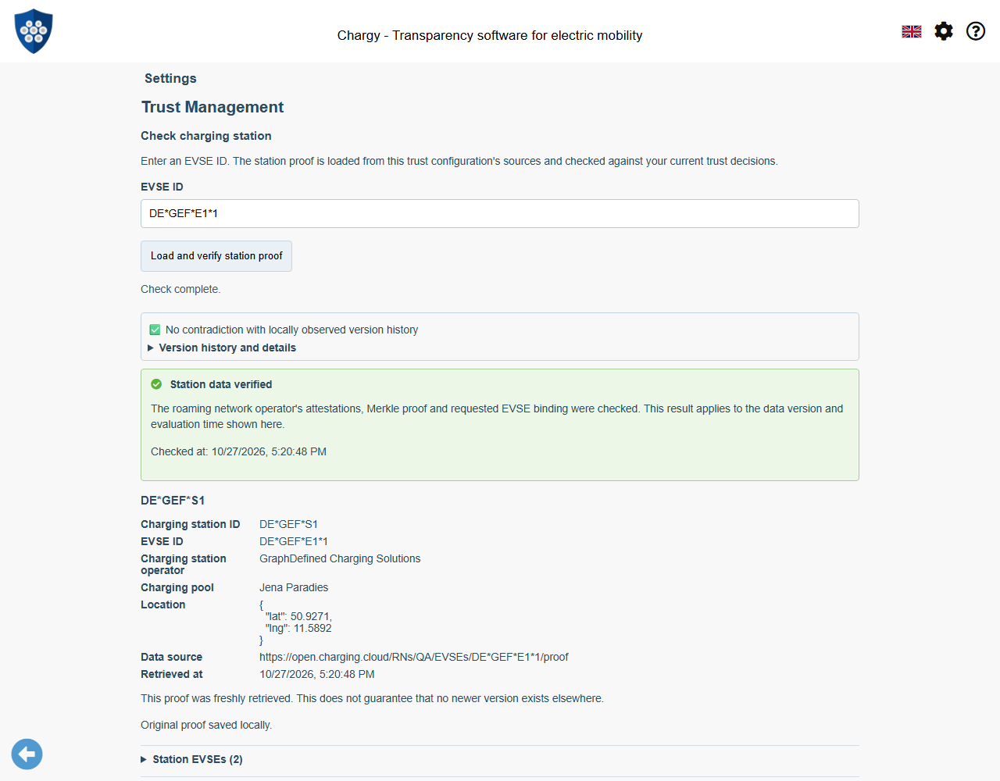
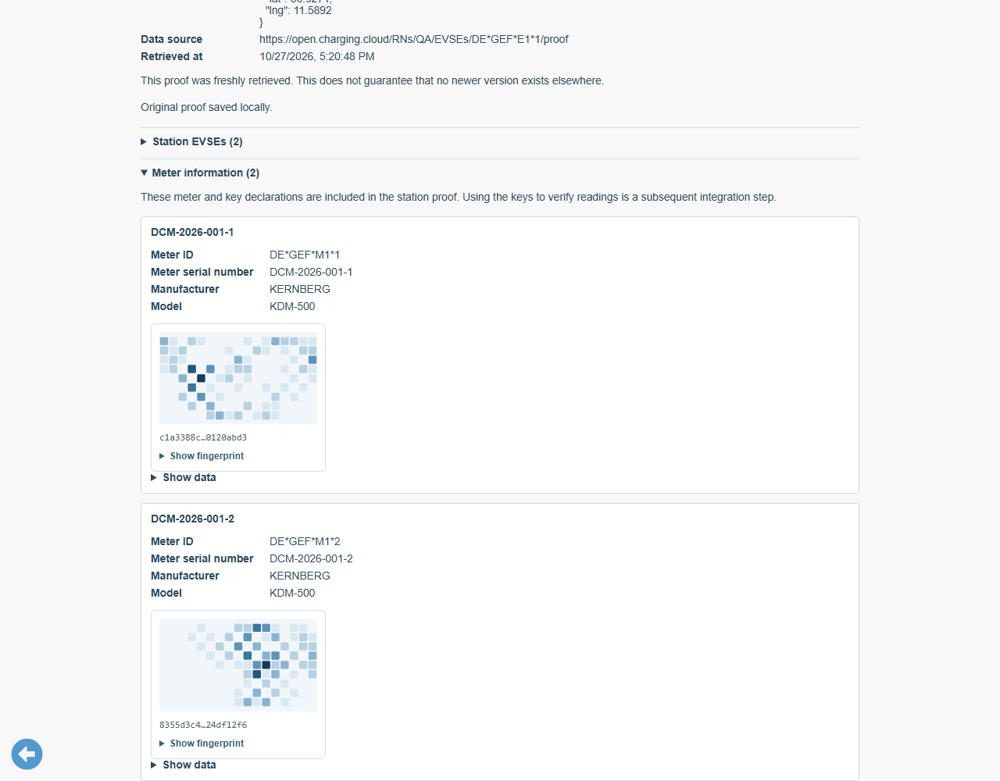
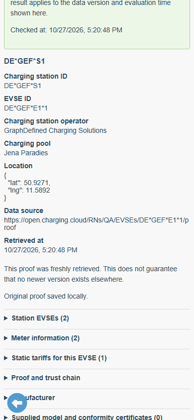

# WWCP/POI: Load and Inspect a Station Proof

Status: 2 November 2026. The mobile port uses the published npm releases
WWCP POI **0.2.0** and ChargyCore **0.18.0**. Package integrity is recorded in
package-lock.json; no development tarballs are required. See the
[mobile integration and verification guide](WWCP-POI-Mobile-Port.md).
This document distinguishes implemented flows from remaining proposals.

✅ **Settings → Trust Management → Roaming networks → select network → Check
charging station** accepts one EVSE ID and retrieves its station proof. This is
the first manual step toward the [session/live-link workflow](WWCP-POI-Session-and-Live-Trust.md).
A [session-bound panel and completed Drag & Drop example](WWCP-POI-Session-Integration.md)
now reuse this verifier. Fully automatic discovery/refresh and meter-key handoff
to Core remain subsequent steps.

## User journey and trust boundary

1. Choose an imported roaming-network configuration. Opening the check page
   reevaluates its original KeyStatement against current local key decisions,
   exclusions and time. An import with insufficient trust can still be inspected
   and deleted, but cannot authorize a station download.
2. Enter the EVSE ID, such as `DE*GEF*E1*1`, and select **Load and verify station
   proof**. The app requests `GET {anchor-source}/EVSEs/{encoded-EVSE-ID}/proof`.
   Sources come exclusively from this saved anchor policy; the EVSE prefix or
   returned proof cannot introduce another source or trust anchor.
3. The app reads current trust again after the download and calls
   `POITrustService.verifyStation`, which delegates to the library's
   `verifyChargingStation(TrustContext, ...)`. It checks the requested EVSE,
   RNO signing-key certificates, authorized distinct-holder root attestations,
   quorum and Merkle inclusion against the bound KeyStatement.
4. Successful results show a green field and check icon; library warnings make
   that field amber and are available in details. Failed verification shows an
   error with expandable per-source download/verification diagnostics and no
   successful station result. A failed source is followed by the next saved
   source, including when it returned a mathematically invalid proof.
5. Original verified proof text and provenance are saved automatically in a
   local cache. A storage failure preserves the verification result, explicitly
   marks it unsaved and offers a retry that reevaluates trust before saving.
   Cancel or navigation aborts the operation and suppresses late results.

```mermaid
sequenceDiagram
    actor User
    participant App
    participant Store as Local decisions / proof cache
    participant Source as Saved anchor source
    participant POI as Shared WWCP/POI verifier
    User->>App: Select network; enter EVSE; load
    App->>Store: Read original KeyStatement and current decisions
    App->>POI: Create authorized TrustContext at current time
    App->>Source: GET /EVSEs/{id}/proof
    Source-->>App: Pruned ChargingStationProof
    App->>Store: Reread current local trust
    App->>POI: Verify proof for requested EVSE
    alt Valid proof
        POI-->>App: Verified station, dependencies and warnings
        App->>Store: Save original JSON and provenance
        App-->>User: Qualified result; expandable details
    else No source supplies a valid proof
        App-->>User: Failure and per-source diagnostics
    end
```

The endpoint returns a standalone `ChargingStationProof`, **not** the enclosing
session-evidence bundle. The genuine example is the `chargingStationProof` field
of [evidence.json](examples/poi-session-live/evidence.json); its provenance is
recorded [alongside it](examples/poi-session-live/provenance.json). The app never
downloads a complete station directory.

Requests omit credentials and cache reuse, reject redirects, enforce the app's
transport rules (HTTPS/public targets in production), and accept at most **2 MiB**
of valid UTF-8 JSON. A source has **15 seconds**; the operation has **30 seconds**
overall. Production servers must allow the app origin through CORS. Duplicate
JSON keys and number canonicalization are handled by the shared POI parser.
Transport, UI and storage are app responsibilities; signature and inclusion
rules remain in the library for reuse by desktop and mobile apps.

## Result and progressive details



The result shows station, selected EVSE, CPO, pool, location, source and retrieval
time. The green field applies to the **attested data version and evaluation
time shown**, not every possible claim about the station. A newly retrieved,
valid document does not establish that no newer version exists elsewhere.

Expandable sections expose all station EVSEs with the requested one highlighted;
meter IDs, serial numbers, models and key fingerprints; static tariff definitions
for the selected EVSE; counted attestation holders and quorum; commit, revision,
tree root and KeyStatement digest; supplied certificates and software declarations;
and the original proof, including audit paths and signature material.



These genuine meter/key declarations are included in the station proof. The
Drunken Bishop raster is the same visual fingerprint used for anchor keys.
The complete hash remains accessible. Reading-signature verification, key
selection for a concrete session and its provenance handoff to Core are still
separate work. Similarly, static tariff inclusion is distinct from a runtime
price, applicability to a particular charge, or independently proven publication.
Supplied manufacturer/metrology certificates are inspectable declarations;
their presence is not a separate legal-conformity verdict.



Large dependency lists are capped in the rendered summaries, with an explicit
notice; the original bounded document remains available. All source-supplied
text and raw JSON use text nodes, not executable HTML.

## Cache and deletion

IndexedDB `ChargyTrustManagement` is now schema **version 2**. Migration retains
the version-1 anchors, manual decisions and bundled-key exclusions and adds
`poiStationProofs` with this record shape:

```typescript
interface StoredStationProof {
    id: string;             // SHA-256(policy ID, EVSE ID, SHA-256(original text))
    anchorPolicyId: string; // exact saved bootstrap policy, not just RN ID
    anchorQRCode: string;  // canonical original anchor for provenance checking
    evseId: string;
    sourceURL: string;
    downloadedAt: string;   // UTC ISO timestamp
    checkedAt: string;      // original evaluation time; never reusable authority
    text: string;           // original UTF-8 proof text
}
```

Original bytes represented by `text` are not reserialized before caching.
Identical text for the same EVSE/policy creates one record and retains its first
retrieval provenance; distinct raw documents remain separate. Reading the cache
checks its identity and provenance. There is no stored green authorization flag.

The page lists the ten most recently retrieved distinct proofs for this policy.
**Open and recheck** runs the original document through current local trust and
current-time verification without a download. Expired attestations or withdrawn
trust therefore cannot retain an old success. Returning focus to a displayed
result also reevaluates it. **Delete saved proof** removes that cache record.

Deleting an anchor or the selected network configuration removes its associated
proof cache in the same transaction. The UI states this explicitly. This is a
cache, not an immutable historical session archive: future `sessionEvidence`
must have its own retention and historical-policy rules. Browser eviction or
clearing site data can remove this cache. Export/import and durable retention
remain future work.

## Verification and screenshot maintenance

`tests/stationProofData.test.ts` checks real signed proofs, authorization rereads,
wrong subjects, tampering, expiry, mirror fallback, invalid/oversized input,
transport restrictions, cancellation and deadlines. Browser regression checks
in `build-tools/captureStationProofScreenshots.mjs` exercise actual user trust
decisions, version-1 migration, a successful load, reload/offline recheck,
deduplication, wrong EVSE, cancellation, quota failure/retry, trust withdrawal
during a pending download, expiry, navigation
and anchor/cache deletion. No verification outcomes are injected.

Run `npm run docs:screenshots:station-proof` after any relevant UI, storage or
trust-gating change and inspect all resulting images. The fixed capture time is
inside the genuine fixture's short attestation window; do not extend signed
timestamps to make the fixture pass. Keep images, captions and
[capture metadata](screenshots/station-proof/capture-info.json) together. CI
regenerates them and uploads the browser-check artifacts. The setup is described
in [the screenshot README](screenshots/station-proof/README.md).
