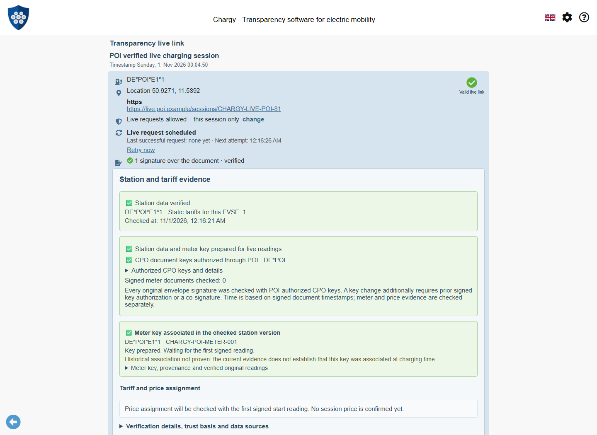
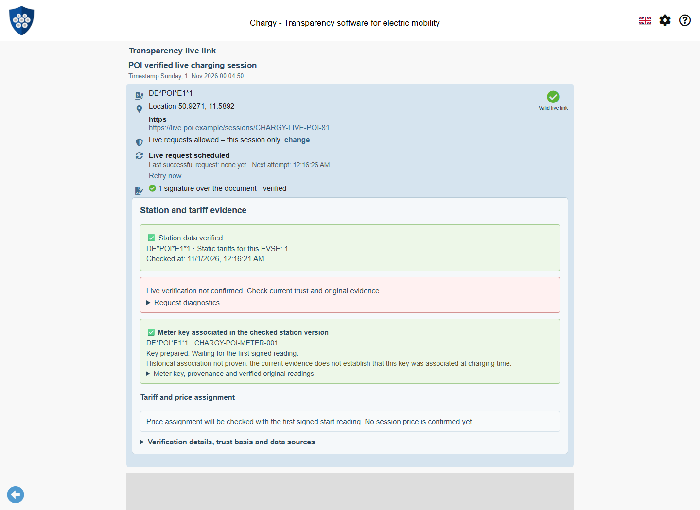
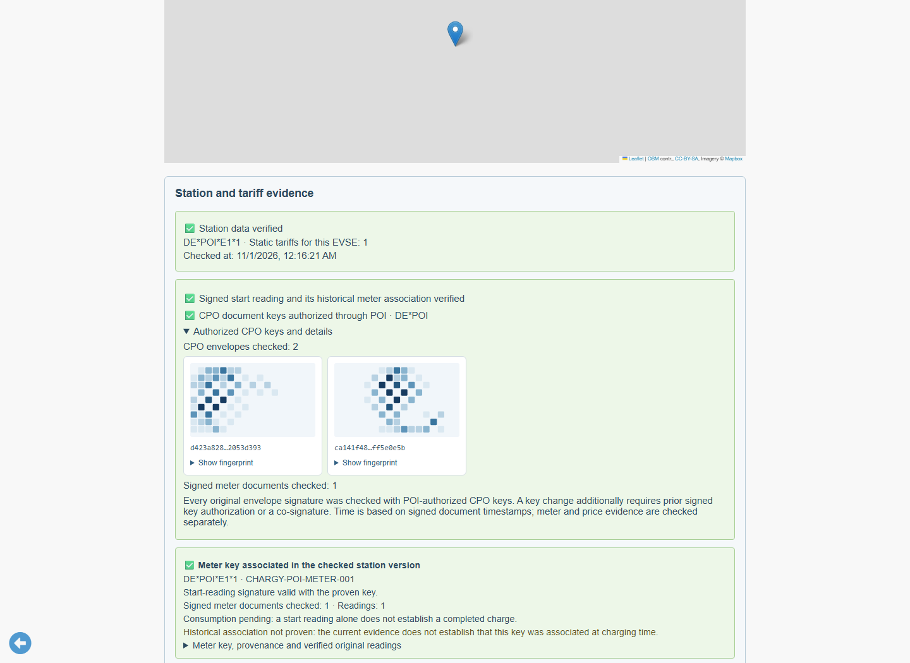
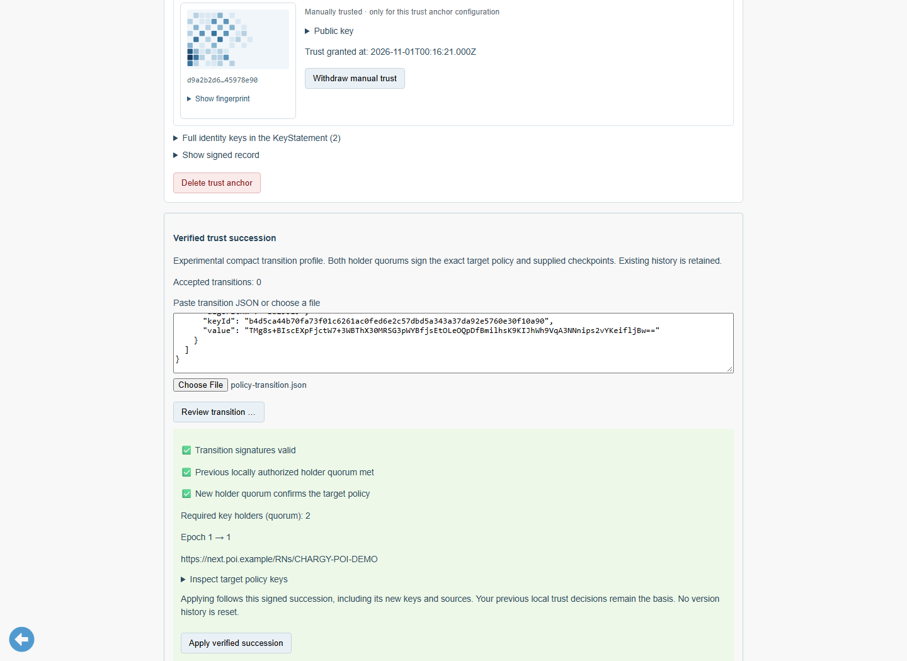
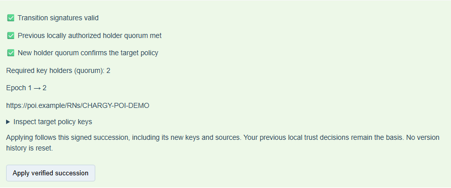
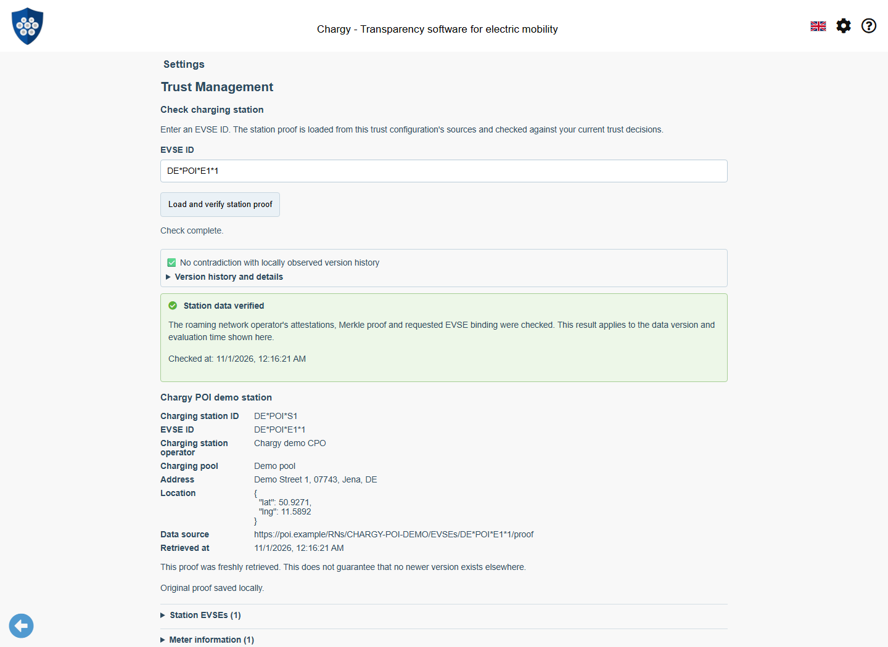
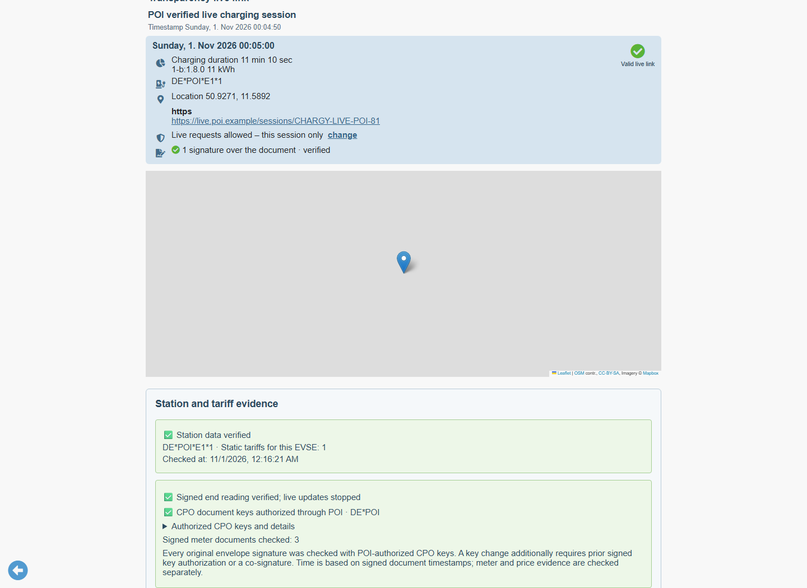
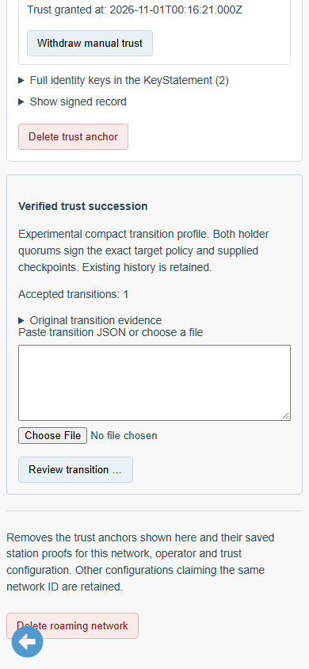
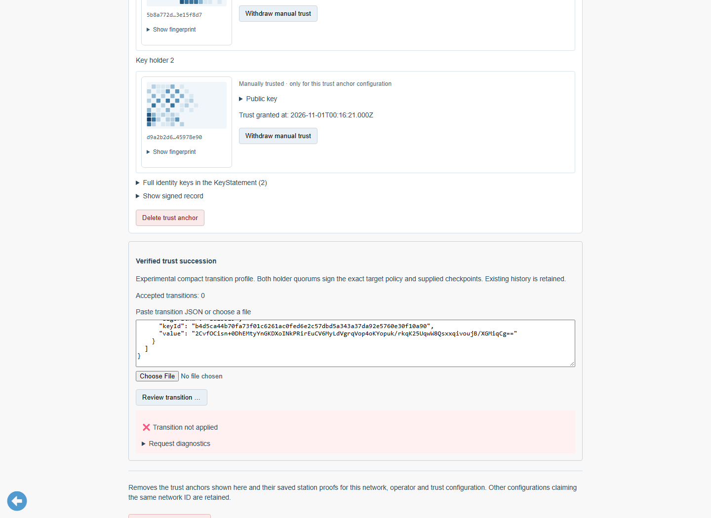

# CPO authority and verified trust succession

The POI live pilot verifies the first and every following original live envelope
with document keys from the RNO-attested CPO of the selected station/EVSE. Its own
embedded public-key list establishes no external authority. Meter signatures,
historical association, selected fixed prices and local version consistency remain
separate checks. The shared rules live in WWCP_POI and ChargyCore; the app owns
storage, review and the explicit decision to follow a successor.

## First envelope and CPO document-key rotation

```mermaid
sequenceDiagram
    participant Provider
    participant App as Chargy
    participant POI as WWCP_POI
    participant Core as ChargyCore
    Provider->>App: Original live envelope + station proof
    App->>POI: Current local authorization + EVSE/CPO + declared document time
    POI-->>App: Authenticated CPO document keys, validity, normalized COSE material
    App->>Core: Original envelope + independently authorized keys
    Core-->>App: Identity and complete envelope signatures checked
    App->>App: Compare persistent history; display scoped result
    Provider->>App: Key transition: new POI proof + old/new co-signed envelope
    App->>POI: Authenticate new key use and proof
    App->>Core: Check exact predecessor, old authorization and new signatures
    Core-->>App: Following envelope may use the authorized new key alone
```

`verifyChargingDocumentKeys` authenticates the original proof at the signed
document timestamp, checks the exact CPO/EVSE, key validity and usage, and normalizes
the keys for Core. The explicit library-extension usage is
`chargeTransparencyRecords`; an unrestricted party key retains its existing broad
meaning. A key restricted to `priceStatements` alone cannot sign a live envelope.
The Core usage remains `signCTRs`. COSE thumbprints and the envelope's declared
SPKI hash identification are different schemes; Core derives its own identification
from the authenticated material instead of comparing unrelated hash strings.

`verifyLiveSessionAuthority` verifies every envelope signature using only that
independently supplied key set and checks CPO/station/EVSE identity. A change of
document keys additionally needs a signature authorized by the previous signed
key list. A co-signed bridge is the usual case. A key already announced in that
previous, completely signed list can also continue. New POI membership alone does
not replace this continuity requirement. Algorithms supported by the generic
POI/Core document verifiers are available independently of the P-256/OCMF meter
pilot.

The app retains the station-proof association of each original envelope. Updating
the current proof does not rewrite the proof used to authenticate an earlier one.
Historical station evidence may grow by appending original versions; prior
versions cannot be replaced. The selected fixed-price evidence stays pinned.







## Explicit compact policy delegation

`trustTransition/v1` is an **experimental library extension** for compact local
trust-policy delegation. It is not the existing History succession wire format,
does not claim owner/change-set replay and does not call `OperatorTrust.followedBy`
without the history that method requires. Its purpose is to avoid downloading a
complete million-station snapshot merely to approve a key/source policy change.

Both the old locally authorized identity-holder quorum and the new target quorum
sign the complete transition: exact source policy and statement digest, target
anchor and complete operator, sequence/predecessor, validity and optional checkpoint
and epoch evidence. Signatures are domain-separated by side, algorithm and key ID.
The target KeyStatement and operational-key certificates must also verify normally.
Changing the URL, holder grouping, signatures, checkpoint or target statement
invalidates the delegation. Existing holders cannot be split by relabeling their
known keys. This profile refuses reductions of the required holder quorum; a user
who intentionally wants a weaker independent trust basis must make that distinct
local decision separately.

The following is an **abbreviated schema illustration**, not a usable signed
fixture. The complete signed examples are linked below.

```json
{
  "@context": "https://open.charging.cloud/contexts/wwcp/trustTransition/v1",
  "sequence": 0,
  "fromPolicyId": "SHA256 of the exact previous bootstrap policy",
  "fromStatementDigest": "SHA256 of its signed KeyStatement content",
  "toAnchor": "compact target TrustAnchor, including URLs/holder groups/quorum",
  "toOperator": {
    "@id": "CHARGY-DEMO-RNO",
    "identityKeys": ["complete public key objects"],
    "minConsensus": 2,
    "keyStatement": "complete signed KeyStatement object",
    "signingKeyCertificates": ["complete signed operational certificates"]
  },
  "signedAt": "2026-11-01T00:15:45.000Z",
  "validUntil": "2030-01-01T00:00:00.000Z",
  "checkpoints": [],
  "signatures": [
    {"side": "old", "algorithm": "Ed25519", "keyId": "old-holder-A", "value": "signature"},
    {"side": "old", "algorithm": "Ed25519", "keyId": "old-holder-B", "value": "signature"},
    {"side": "new", "algorithm": "Ed25519", "keyId": "new-holder-A", "value": "signature"},
    {"side": "new", "algorithm": "Ed25519", "keyId": "new-holder-B", "value": "signature"}
  ]
}
```

For sequence 1 onward, `previous` is the SHA-256 digest of the preceding transition
content. Each side signs the canonical content plus `side`, `algorithm` and
`keyId`; the `signatures` array itself is excluded. These signatures authorize
delegation, not global freshness, independent actual time or witness independence.

### User interaction and storage

In **Settings → Trust Management → Roaming networks → network → Verified trust
succession**, paste the JSON or choose a file. Review performs real cryptography
and local-history comparison. It shows both holder quorums, target sources, target
key fingerprints, epoch numbers and the experimental scope. It grants no new
local key permission. Only **Apply verified succession** appends the original
certificate to the selected bootstrap record.



The original bootstrap ID, QR content, statement and explicit local key decisions
remain intact. The record stores a bounded `transitions` array of original text
and local acceptance times. Derived keys are not copied into the bundled roots or
the manual-key list. Every resolver operation reconstructs the accepted chain from
current local roots and re-verifies each original certificate. Local withdrawal or
deletion of that root disables the derived authority. Root-key expiry after a
valid handoff does not make the old signature mathematically invalid at its
declared signing time; expiry and authorized compromise/revocation evidence have
different meanings.

Acceptance compares the reviewed record and current key exclusions in one
IndexedDB transaction. Concurrent user decisions cannot be overwritten. Journal
advancement is a separate fail-closed step: no data verdict is released until it
has adopted the authenticated transition atomically with its existing negative
knowledge. If this second step fails, the original accepted certificate remains
available for diagnosis/retry; the application does not erase history or fall back
to the old policy. Other tabs and pending views are invalidated on successful
application. Restoring only an old anchor while its journal remembers later
succession cannot bypass the need to restore those original certificates.

The original transition must be accepted within its signed validity interval.
Later rechecks retain that recorded acceptance time and validate the current target
statement separately. Signed timestamps are still assertions: this does not supply
independent time or prove that a private key was uncompromised before a handoff.
RNO identity changes, arbitrary lower-quorum policies and merges of unrelated
bootstrap roots are intentionally outside this compact profile.

## Epoch continuation without resetting history

An epoch-changing certificate additionally carries the old checkpoint line ending
in a signed final checkpoint, the exact deterministic genesis and the first signed
checkpoint of the next epoch:

```json
{
  "checkpoints": ["original old-epoch checkpoints through the final checkpoint"],
  "epochChange": {
    "genesis": "complete Commit.genesisOf(final RN, final ETags, final.next)",
    "firstCheckpoint": "complete signed next-epoch checkpoint 0"
  }
}
```

These are objects in actual JSON. The next number must be exactly one higher.
The first checkpoint names the final checkpoint, its epoch and ETags, and must
be of the deterministic genesis, revision 0. The previous and next signature
profiles each require an authorized holder quorum. Unknown profiles, altered
genesis, missing predecessor paths, old rollback points and unresolved forks
cannot be hidden by the transition. The final checkpoint may close the same
root as its predecessor, as the existing epoch rules permit.

For a combined identity/policy and epoch handoff, the certificate activates at
the first new checkpoint's declared time. This keeps historical authority
selection unambiguous. The independent epoch-only example retains its existing
identity policy. Current attestations must not predate the verified epoch start.

Old coordinates and contradictions remain stored. Only the verified transition
can move the active station/checkpoint heads to the new epoch. Current proofs then
use its identification hash and permitted signature algorithms. Historical
measurement-time authorization follows the verified policy timeline. New epochs
do not reset entity price chains or rebind a fixed session price.





## Live pilot and reproducibility

The genuine fixture series starts under the original policy, rotates its CPO
document key, applies a dual-quorum RNO/key/source policy change, and completes
with a signed meter reading under the new historical authority interval. The
original start price remains 0.35 EUR/kWh. The original old/new station versions
have real commit inclusion proofs; opening the retained live chain after reload
rechecks current local root decisions and every original envelope.







See [public signed fixtures](../tests/fixtures/POITrustTransitions/README.md).
Generate them with `npm run fixtures:poi-succession:generate`. Run
`npm run docs:screenshots:poi-succession` to exercise the real browser UI and
refresh nine screenshots. Regenerate and visually review images and capture
metadata whenever these trust, live or management flows change. The mobile port
uses the published WWCP POI 0.2.0 and ChargyCore 0.18.0 releases.
